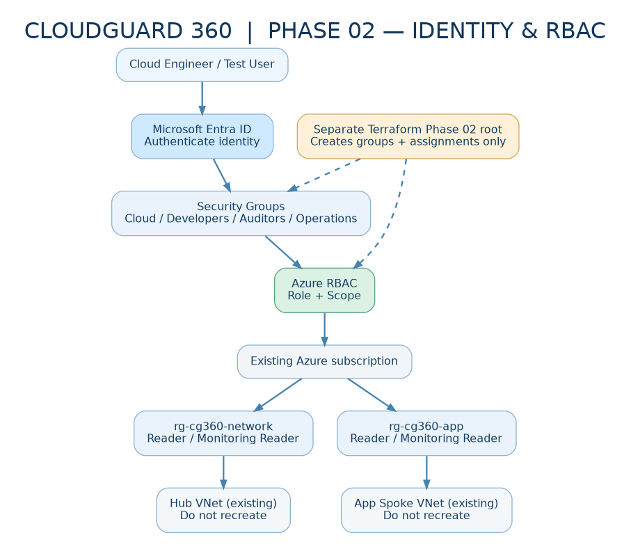
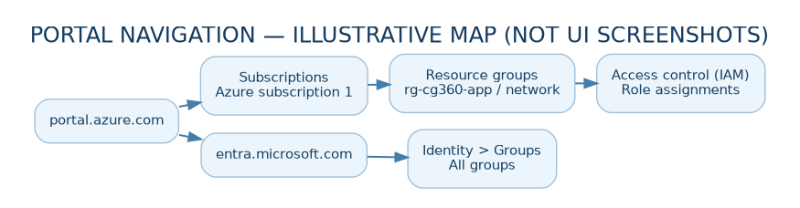
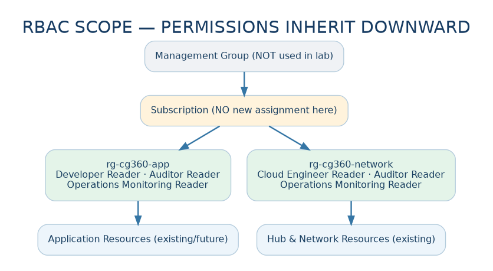
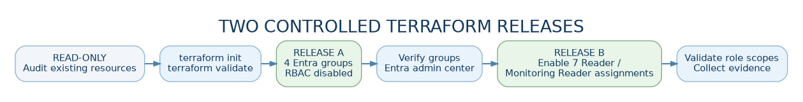

# CloudGuard 360 — PHASE 02 MASTERCLASS

**Enterprise Identity, Azure RBAC & Security Governance with Terraform**  
**Complete hands-on handbook · English · Azure Cloud Shell (Bash) · Microsoft Entra ID · Free-trial-aware**

> **Start here.** This guide covers **Subphases 00–08**, from opening the Azure Portal to final sign-off. It supports both a **fresh Phase 02 installation** and **your existing environment, where the four groups and seven RBAC assignments may already have been created**. Never overwrite an existing Terraform state. Do not run Terraform from a new copy of the identity template if the groups are already managed by the earlier project.



## Project overview — Your current situation and target

Your **Phase 01 networking** has been completed with Terraform: two Resource Groups (`rg-cg360-network`, `rg-cg360-app`), a Hub-and-Spoke VNet pair, three subnets, a network security group and two VNet peerings. Phase 02 provides the *identity and governance layer* on top of this existing environment. **Nothing here should recreate the VNets.**

| Technology | Responsibility | Scope in this lab |
|---|---|---|
| Microsoft Entra ID | Identity objects and groups | Four `CG360-*` security groups |
| Azure RBAC | Permissions on Azure resources | Seven initial read-only assignments |
| Terraform (AzureAD provider) | Manage Entra groups | Isolated identity Terraform root |
| Terraform (AzureRM provider) | RBAC, audit-only Azure Policy | Existing RGs referenced as read-only data |
| Azure Policy | Audit governance rules | One optional assignment at `rg-cg360-app` |
| Azure CLI / Cloud Shell | Inspection and verification | Read-only commands where possible |
| Azure Files (`~/clouddrive`) | Persist Cloud Shell files | Training workspace; use Azure Blob remote state later |

**Target role matrix (7 assignments):**

| Entra security group | `rg-cg360-app` | `rg-cg360-network` |
|---|---|---|
| `CG360-Cloud-Engineers` | Reader | Reader |
| `CG360-Developers` | Reader | No additional assignment |
| `CG360-Security-Auditors` | Reader | Reader |
| `CG360-Operations` | Monitoring Reader | Monitoring Reader |

**Key distinction:** An empty group grants *nobody* access. Being in one of these groups does not cancel more permissive roles inherited from a subscription or another group.

### Nine subphases and acceptance gates

| Subphase | Hands-on outcome | Gate before moving on |
|---|---|---|
| **00 — Prepare** | Azure CLI, storage, folder and correct subscription | Preflight successful |
| **01 — Inventory** | Identify existing network resources and costs | Resource Groups and VNet peering verified |
| **02 — Discover IAM** | Explore Entra users, groups, directory roles and Azure IAM | Understand role + identity + scope |
| **03 — Entra groups** | Four security groups created or verified in existing Terraform state | Exactly 4 managed groups; no unexpected changes |
| **04 — Azure RBAC** | Seven read-only assignments created or verified | Exactly 7 expected assignments at intended RG scopes |
| **05 — Least privilege** | Evaluate inherited access; optional authorised user test | Demonstrate limits without destructive operations |
| **06 — Azure Policy** | Optional audit-only location policy via *separate* Terraform root | A single audit policy; zero unexpected changes |
| **07 — Evidence** | Reproducible evidence archive, findings and risk notes | Evidence reviewed, missing checks marked OPEN |
| **08 — Closure** | Read-only final validation and Phase 03 handover | Sign off only what is verified |

### Rules for every step

1. Use **Bash** in Azure Cloud Shell. Do not run `az login` inside an already authenticated Cloud Shell unless genuinely switching identity; your earlier device-code attempt was blocked by Security Defaults.
2. Keep `~/clouddrive` mounted. Terraform state files and saved plans may contain sensitive information; do not upload them to a public repository.
3. Verify your **actual subscription name** and remaining Azure trial credit before deploying anything. **Azure Policy Audit creates no VM/AKS and normally requires no new compute, but Cloud Shell storage can have charges.**
4. Use **separate Terraform roots** for Phase 01 networking, Phase 02 identity, and Phase 02 governance policy. Each maintains its own state.
5. **Never run `terraform apply` if the plan changes/deletes an existing VNet, Resource Group, identity group, or role unexpectedly.** A saved `.tfplan` is specific to the plan you reviewed.
6. Group creation permissions in Entra and role-assignment permissions in Azure are different. Do not grant yourself extra rights to work around a failure.
7. Screenshots and outputs should be redacted before sharing. Do not publish credentials, full state files, subscription/tenant IDs, personal UPNs, or user object IDs.

---

## SUBPHASE 00 — Workspace, tools and safe start

**Goal:** find the already-deployed lab, ensure that Cloud Shell is persistent, and identify the right working folders. **No Azure changes**.

### 00.1 — Open Azure Portal

1. Visit **https://portal.azure.com/** and sign in with the account used for the earlier networking deployment.
2. In the top bar, select the terminal icon **Cloud Shell** (`>_`).
3. Choose **Bash**. If Cloud Shell asks you to configure storage, choose the persistent storage / *Mount storage account* option, review any associated Azure Files cost, and complete the wizard.
4. If you previously chose an ephemeral session, open Cloud Shell **Settings → Reset User Settings**, then relaunch with persistent storage; first download any transient files you need to preserve.
5. Keep this Cloud Shell tab open while executing the instructions below.



### 00.2 — Confirm that you have a persistent mount and working tools

```bash
# Run in Azure Cloud Shell - Bash
mountpoint -q "$HOME/clouddrive" && echo 'PASS: persistent mount' || echo 'STOP: no persistent mount'
terraform version
az version
az account show --query '{Name:name,State:state}' --output table
```

**Expected:** `PASS: persistent mount`, Terraform/Azure CLI version information, and a subscription in the `Enabled` state. If not, **stop here**.

**Why:** the machine behind Cloud Shell is temporary. Your `clouddrive` Azure Files mount persists project files. For a production-grade Terraform collaboration workflow you will ultimately use a secured Azure Blob Storage backend with state locking; Cloud Shell Files persistence by itself is not that backend.

### 00.3 — Set Azure provider context without printing IDs

```bash
export ARM_SUBSCRIPTION_ID="$(az account show --query id -o tsv)"
export ARM_TENANT_ID="$(az account show --query tenantId -o tsv)"
[ -n "$ARM_SUBSCRIPTION_ID" ] && echo 'PASS: subscription configured'
```

**Expected:** `PASS: subscription configured`. The exports must be repeated after starting a new Bash session. The AzureRM 4.x provider needs the subscription ID; neither value should be committed as source code.

### 00.4 — Download this ZIP and upload it to Cloud Shell

1. In the ChatGPT response, click **CloudGuard 360 — Phase 02 Masterclass ZIP** and save it on your PC.
2. Return to Cloud Shell and select **Manage files → Upload**.
3. Choose the downloaded `CloudGuard360_Phase02_Masterclass.zip`.
4. In Bash, run `ls -lh ~/CloudGuard360_Phase02_Masterclass.zip`. If the file is not present, check the destination reported by Cloud Shell's upload feature.
5. Extract to `clouddrive` without overwriting your earlier Phase 02 directory:

```bash
mkdir -p "$HOME/clouddrive/cloudguard360"
unzip -n "$HOME/CloudGuard360_Phase02_Masterclass.zip" -d "$HOME/clouddrive/cloudguard360"
cd "$HOME/clouddrive/cloudguard360/CloudGuard360_Phase02_Masterclass"
pwd
ls -la
```

**Expected:** you see `index.html`, `terraform.md`, `policy-audit/`, `templates/`, `scripts/` and `assets/`. The ZIP contains **one top-level folder** named `CloudGuard360_Phase02_Masterclass`.

**Download failure?** If ChatGPT displays *This action couldn't be completed*, try the individual Markdown/HTML links, or create the Terraform files using the documented snippets. Do not depend on an unverified public download URL.

### 00.5 — Detect whether your original Phase 02 deployment already exists

```bash
bash scripts/00-detect-workspace.sh
```

**Expected for your ongoing lab:** the existing root is detected at `~/clouddrive/cloudguard360/CloudGuard360_Phase02_Identity_RBAC/terraform`. If it contains an existing state, use **that original Terraform root** for Subphases 03–05. **Do not copy over or replace its state with the template inside this package.**

If you genuinely have no Phase 02 root yet, the template is in `templates/identity-rbac`. Copy it into a *new persistent* folder and then follow Subphase 03. Never do this if the groups already exist and are managed by your previous Terraform configuration.

**Checkpoint 00:** Cloud Shell mounted, correct subscription selected, no duplicate Phase 02 deployment attempted.

---

## SUBPHASE 01 — Validate the existing Azure network

**Goal:** verify Phase 01 is real and in the expected subscription. These commands only read Azure resources.

### 01.1 — Inspect the two Resource Groups

In **Azure Portal → search “Resource groups”**, open `rg-cg360-network` and `rg-cg360-app`. In both, confirm the resource names and labels. Then use the terminal:

```bash
az group show --name rg-cg360-network --query '{Name:name,Location:location}' -o table
az group show --name rg-cg360-app --query '{Name:name,Location:location}' -o table
```

**Expected:** both Resource Groups exist. The Resource Group metadata location does not necessarily match its VNets' region.

### 01.2 — Read the deployed VNet address spaces and actual region

```bash
az network vnet show -g rg-cg360-network -n vnet-cg360-hub \
  --query '{Name:name,Region:location,Prefixes:addressSpace.addressPrefixes}' -o json
az network vnet show -g rg-cg360-app -n vnet-cg360-app \
  --query '{Name:name,Region:location,Prefixes:addressSpace.addressPrefixes}' -o json
```

**Expected:** Hub `10.0.0.0/16`; Application `10.10.0.0/16`. Your original attempt in `westeurope` received `RequestDisallowedByAzure`; the working region must be read from the actual VNet rather than guessed. **Do not recreate the network**.

### 01.3 — Verify the peering relationships

```bash
az network vnet peering list -g rg-cg360-network --vnet-name vnet-cg360-hub \
  --query '[].{Name:name,State:peeringState}' -o table
az network vnet peering list -g rg-cg360-app --vnet-name vnet-cg360-app \
  --query '[].{Name:name,State:peeringState}' -o table
```

**Expected:** two peerings in `Connected` state. This proves the control-plane peering was established; it does **not** prove an application-level packet flow, because no test workloads have been deployed.

### 01.4 — Inspect cost controls

In Azure Portal, navigate to **Cost Management + Billing → Cost Management → Budgets** at the correct scope. Check remaining Free Trial credit, expiry date, current charges, and budget alerts if available. Budgets do **not** automatically prevent charges. The Phase 02 exercises do not require AKS, Windows VMs, Azure Firewall or public IP addresses.

**Checkpoint 01:** both Resource Groups accessible, VNets and CIDRs correct, peerings `Connected`, credit/charges reviewed.

---

## SUBPHASE 02 — Entra ID and Azure RBAC discovery

**Goal:** understand identity, authorisation, groups and role scope before creating anything. **Read-only**.



### 02.1 — Identify the correct Microsoft Entra tenant

1. Open **https://entra.microsoft.com/** with the account associated with your Azure subscription.
2. Navigate to **Entra ID → Overview**.
3. Inspect the directory name and tenant information. Compare the directory shown in Azure Portal's **Subscriptions** overview.
4. Do not copy the Tenant ID into public screenshots or GitHub documentation.

### 02.2 — Browse user accounts

In Entra Admin Center select **Entra ID → Users → All users**. Open your own account in read-only mode and locate its user principal name, Object ID, Group memberships and (where available) Directory roles. **Object ID** uniquely identifies an Entra object; it is not your Azure subscription ID.

### 02.3 — Inspect existing groups

Select **Entra ID → Groups → All groups** and search for `CG360-`. Initially there may be **zero groups**. If your earlier Terraform work succeeded, you should see four. **Do not create duplicates manually.**

```bash
az ad group list --filter "startswith(displayName,'CG360-')" \
  --query '[].{Name:displayName,SecurityEnabled:securityEnabled}' -o table
```

If a Microsoft Graph permission error appears, record it. Do not disable Security Defaults to bypass access control.

### 02.4 — Compare Entra directory roles with Azure RBAC roles

In **Entra ID → Roles & admins**, inspect *Groups Administrator* and related roles. In the Azure Portal open **Resource groups → rg-cg360-app → Access control (IAM) → Role assignments**. Directory roles manage directory objects; Azure RBAC roles manage Azure resource operations. An Azure subscription Contributor does **not** automatically become a Groups Administrator.

### 02.5 — Inspect RBAC and inheritance without changing anything

```bash
az role assignment list --resource-group rg-cg360-app --include-inherited \
  --query '[].{Role:roleDefinitionName,Type:principalType,Scope:scope}' -o table
az role assignment list --resource-group rg-cg360-network --include-inherited \
  --query '[].{Role:roleDefinitionName,Type:principalType,Scope:scope}' -o table
```

**Meaning:** a role at Subscription scope can be inherited by both RGs. Roles created on `rg-cg360-app` don't automatically affect `rg-cg360-network`. *Effective access* is the combination of all applicable role assignments, including group memberships and inherited roles.

**Checkpoint 02:** find the Entra tenant, users, `CG360-*` groups, directory roles, and role assignments in both RGs.

---

## SUBPHASE 03 — Create or verify four Microsoft Entra groups with Terraform

**Goal:** bring the four groups under Terraform management, without adding members or granting Azure RBAC yet.

### 03.1 — Choose the correct Terraform root (critical)

**If you already completed Subphase 03:** stay in your **existing** root. Do not copy the template files onto it, do not delete state, and do not run another fresh apply from this ZIP.

```bash
IDENTITY_ROOT="$HOME/clouddrive/cloudguard360/CloudGuard360_Phase02_Identity_RBAC/terraform"
cd "$IDENTITY_ROOT"
export ARM_SUBSCRIPTION_ID="$(az account show --query id -o tsv)"
export ARM_TENANT_ID="$(az account show --query tenantId -o tsv)"
terraform state list
```

If the state shows four `azuread_group.lab[...]` entries, skip to **03.6**. If the project does not exist and you have **not** created the groups, you can initialise the fresh template:

```bash
# ONLY FOR A FRESH LAB WITH NO EXISTING MANAGED GROUPS
mkdir -p "$HOME/clouddrive/cloudguard360/CloudGuard360_Phase02_Identity_RBAC/terraform"
cp -n "$HOME/clouddrive/cloudguard360/CloudGuard360_Phase02_Masterclass/templates/identity-rbac/"* \
  "$HOME/clouddrive/cloudguard360/CloudGuard360_Phase02_Identity_RBAC/terraform/"
# Include hidden .gitignore (not matched by *).
cp -n "$HOME/clouddrive/cloudguard360/CloudGuard360_Phase02_Masterclass/templates/identity-rbac/.gitignore" \
  "$HOME/clouddrive/cloudguard360/CloudGuard360_Phase02_Identity_RBAC/terraform/.gitignore"
cd "$HOME/clouddrive/cloudguard360/CloudGuard360_Phase02_Identity_RBAC/terraform"
```

The template has `.gitignore`, `main.tf`, `providers.tf`, `rbac.tf`, `variables.tf`, `outputs.tf`, `versions.tf` and `terraform.tfvars.example`. It **does not include your existing Terraform state**.

### 03.2 — Verify permissions to create groups

In Entra Admin Center, inspect **Roles & admins** and any tenant restriction on creating security groups. A directory administrator role may be required depending on settings; in some tenants, default users can create groups. Group creation depends on **Entra directory permissions**, not merely an Azure subscription role. Do not elevate privileges without authorisation.

### 03.3 — Configure variables for Release A (groups only)

```bash
cp -n terraform.tfvars.example terraform.tfvars
nano terraform.tfvars
```

Ensure the important values are:

```hcl
prefix                   = "CG360"
app_resource_group       = "rg-cg360-app"
network_resource_group   = "rg-cg360-network"
enable_role_assignments  = false
enable_app_contributor    = false
demo_member_object_id    = ""
```

Do not add your personal account as a demo member at this stage.

### 03.4 — Initialise, validate and prepare a saved plan

```bash
terraform fmt -recursive
terraform init
terraform validate
terraform plan -out=phase02-groups.tfplan
terraform show -no-color phase02-groups.tfplan | grep -E 'will be created|Plan:'
terraform show -json phase02-groups.tfplan | python3 \
  "$HOME/clouddrive/cloudguard360/CloudGuard360_Phase02_Masterclass/scripts/check_plan.py"
```

**Expected (fresh only):** `Plan: 4 to add, 0 to change, 0 to destroy`, all resources `azuread_group.lab[...]`, guard returns `PLAN PASS`.

**If you already manage the groups:** `terraform plan` should instead show **no changes** when the identity/RBAC configuration is unchanged. Never apply a four-group plan from a new state while the same groups already exist.

### 03.5 — Apply only after reviewing the four-group plan

```bash
# ONLY if a reviewed plan creates exactly the four intended groups
terraform apply phase02-groups.tfplan
```

**Expected:** `Apply complete! Resources: 4 added, 0 changed, 0 destroyed.` If you see `Authorization_RequestDenied` or `duplicate name`, stop. Do not manually create matching groups and then rerun this apply.

### 03.6 — Verify group inventory in Terraform and Entra

```bash
terraform state list | grep '^azuread_group\.lab\['
terraform output security_group_names
az ad group list --filter "startswith(displayName,'CG360-')" \
  --query '[].{Name:displayName,Security:securityEnabled}' -o table
```

Open **Entra ID → Groups → All groups** and confirm four `CG360-*` Security groups. They should be empty until you intentionally manage membership.

**Checkpoint 03:** exactly four expected managed groups, no existing group duplicated, no unreviewed elevated privileges.

---

## SUBPHASE 04 — Apply or audit seven least-privilege Azure RBAC assignments

**Goal:** connect the four groups to Reader / Monitoring Reader on the correct RGs. No changes to VNets.

### 04.1 — Confirm the prerequisite for role assignments

Your signed-in identity needs `Microsoft.Authorization/roleAssignments/write` on each relevant Resource Group or an inherited ancestor scope. This may be included in Owner or Role Based Access Control Administrator; Contributor is normally insufficient. Check your account in **Resource groups → ... → Access control (IAM) → Check access**.

### 04.2 — If seven assignments are already created, audit them

```bash
cd "$HOME/clouddrive/cloudguard360/CloudGuard360_Phase02_Identity_RBAC/terraform"
terraform output rbac_assignment_count
terraform state list | grep '^azurerm_role_assignment\.lab\['
```

**Expected for your later-stage environment:** `7` and seven role-assignment entries. If already present, **do not re-apply a fresh seven-role plan**. Continue to 04.5.

### 04.3 — If not created, enable read-only roles

```bash
nano terraform.tfvars
```

Use these values:

```hcl
enable_role_assignments = true
enable_app_contributor   = false
demo_member_object_id    = ""
```

The assignments are defined in `rbac.tf`. Review them; the intended roles are **Reader** and **Monitoring Reader**, not Contributor.

### 04.4 — Review the seven-role plan, then apply if authorised

```bash
terraform validate
terraform plan -out=phase02-rbac.tfplan
terraform show -no-color phase02-rbac.tfplan | grep -E 'will be created|Plan:'
terraform show -json phase02-rbac.tfplan | python3 \
  "$HOME/clouddrive/cloudguard360/CloudGuard360_Phase02_Masterclass/scripts/check_plan.py"
```

**Expected when groups already exist and RBAC is not deployed:** `Plan: 7 to add, 0 to change, 0 to destroy` with seven `azurerm_role_assignment.lab[...]` addresses; safety guard `PLAN PASS`. Check each role and scope manually before applying.

```bash
# ONLY after you reviewed the exact seven changes and have permission
terraform apply phase02-rbac.tfplan
```

**Expected:** seven assignments created. An authorization error means your account does not have the required authority; do not self-escalate.

### 04.5 — Verify role assignments in Azure

1. Azure Portal → **Resource groups → rg-cg360-app → Access control (IAM) → Role assignments**.
2. Search for `CG360-` and inspect group names, role names and scopes.
3. Repeat in `rg-cg360-network`.
4. If you already have the original `scripts/verify_rbac.sh`, run it; otherwise the copy in this ZIP can be called by its full path:

```bash
bash "$HOME/clouddrive/cloudguard360/CloudGuard360_Phase02_Masterclass/scripts/verify_rbac.sh"
```

**Checkpoint 04:** seven intended assignments confirmed, no Contributor access, and no unexpected network changes.

---

## SUBPHASE 05 — Inheritance, effective access and optional test-user exercise

**Goal:** distinguish *assigned* rights from *effective* rights. Do not test permissions with destructive Azure operations.



### 05.1 — Understand inheritance

A Reader assignment on `rg-cg360-app` allows appropriate Azure control-plane reads within that RG. A role at subscription scope can grant **additional access** across both RGs. Azure RBAC **does not remove** an inherited Owner role simply because the user also belongs to a Reader group. Empty groups grant no new permissions to people.

### 05.2 — Inspect real assignments in the portal

1. Open **Azure Portal → Resource groups → rg-cg360-app → Access control (IAM)**.
2. Choose **Role assignments**. Inspect direct vs inherited role scopes.
3. Choose **Check access** and look up a group (`CG360-Developers`) or a user you are authorised to inspect.
4. Repeat in `rg-cg360-network`.
5. Record the observations in `evidence/` without exposing object IDs publicly.

### 05.3 — Run read-only Azure CLI checks

```bash
az role assignment list --resource-group rg-cg360-app --include-inherited \
  --query '[].{Role:roleDefinitionName,Type:principalType,Scope:scope}' -o table
az role assignment list --resource-group rg-cg360-network --include-inherited \
  --query '[].{Role:roleDefinitionName,Type:principalType,Scope:scope}' -o table
```

For a permitted dedicated lab user only, use their Entra object ID to examine inherited and group-derived assignments; **do not share that ID in a screenshot**:

```bash
# OPTIONAL; only if you have a separate authorised test identity
TEST_USER_ID='REPLACE-WITH-LAB-USER-OBJECT-ID'
az role assignment list --assignee "$TEST_USER_ID" --all \
  --include-groups --include-inherited \
  --query '[].{Role:roleDefinitionName,Scope:scope}' -o table
```

### 05.4 — Optional add-and-remove membership with Terraform

Only if a **non-privileged test identity** exists and you have permission to manage membership:

1. Open your **existing** identity root's `terraform.tfvars`.
2. Set `demo_member_object_id` to the *test user's Object ID*, not the subscription ID.
3. `terraform plan -out=member-add.tfplan`; expect only `azuread_group_member.demo_developer[0]` creation and no other changes.
4. Review, then `terraform apply member-add.tfplan` only if all checks pass.
5. Sign in privately as the test user and confirm App RG read access. Do not press Delete to check denial.
6. Clear the variable back to `""`; review the new plan carefully: it should **destroy only the temporary group membership**, not a group or role.
7. Apply only the reviewed membership cleanup.

**Skip this exercise if you do not have an approved second account.** A portal IAM audit is still a valid conceptual verification; simply record the functional test as *Not Tested* rather than claiming it passed.

**Checkpoint 05:** explain why group-based Reader doesn't override subscription Owner. Test evidence is labelled actual, simulated, or not performed.

---

## SUBPHASE 06 — Azure Policy governance (one new audit-only assignment)

**Goal:** configure a simple location-governance audit using a separate, nonblocking Terraform project. Do not deploy resources into a forbidden region. The policy reads the actual existing App VNet region to avoid the earlier `westeurope` 403 mistake.

### 06.1 — Why a separate policy project?

The completed Phase 02 identity state already manages **four security groups and seven RBAC assignments**. Our optional governance root lives in `CloudGuard360_Phase02_Masterclass/policy-audit` and has its **own state**. It references the existing App RG and VNet as read-only data sources; it cannot recreate your Phase 01 network or take over your identity state.

**Azure RBAC vs Azure Policy:** RBAC answers *who may act*; Policy tests *whether resource configuration follows a rule*. The built-in **Allowed locations** policy (`e56962a6-4747-49cd-b67b-bf8b01975c4c`) supports the `Audit` effect. With `Audit` it reports noncompliance; it does not block deployments. Because it is scoped to the App RG, it doesn't directly govern the Network RG.

### 06.2 — Verify policy availability and your permissions

```bash
az policy definition show --name e56962a6-4747-49cd-b67b-bf8b01975c4c \
  --query '{Name:displayName,AllowedEffects:parameters.effect.allowedValues}' -o json
az provider show --namespace Microsoft.PolicyInsights --query registrationState -o tsv
```

**Expected:** `Allowed locations` and effects including `Audit`. Provider registration or Policy Insights permissions may be needed for compliance querying. Assigning a policy requires `Microsoft.Authorization/policyAssignments/write` at the RG scope (or a parent). Ask an authorised admin if missing.

### 06.3 — Open the isolated policy Terraform project

```bash
cd "$HOME/clouddrive/cloudguard360/CloudGuard360_Phase02_Masterclass/policy-audit"
export ARM_SUBSCRIPTION_ID="$(az account show --query id -o tsv)"
cp -n terraform.tfvars.example terraform.tfvars
cat terraform.tfvars
terraform init
terraform validate
```

The file initially sets `enable_policy_audit = false`; therefore the first plan should not create the policy. Verify the existing VNet is still readable.

```bash
az network vnet show -g rg-cg360-app -n vnet-cg360-app \
  --query '{Name:name,ActualRegion:location}' -o table
terraform plan
```

### 06.4 — Activate the policy audit

Only when your roles and scope are verified:

```bash
nano terraform.tfvars
```

Change **only**:

```hcl
enable_policy_audit = true
```

Now generate a saved plan:

```bash
terraform fmt -check
terraform validate
terraform plan -out=policy.tfplan
terraform show -no-color policy.tfplan | grep -E 'will be created|Plan:'
terraform show -json policy.tfplan | python3 ../scripts/06-policy-plan-guard.py
```

**Expected for a new policy state:** exactly **one** `azurerm_resource_group_policy_assignment.locations_audit[0]` creation; safety checker prints `PLAN PASS`. The `terraform show` output must confirm `Audit`, the actual App VNet region, and scope `rg-cg360-app`.

**If the built-in policy is already assigned outside Terraform, stop.** Do not create a duplicate. Decide with an administrator whether to leave it untouched or import it into this state; never import without explicitly reviewing the destination state.

### 06.5 — Apply the policy only after the guard passes

```bash
# ONLY after reviewing exactly one policy creation
terraform apply policy.tfplan
terraform output policy_assignment_count
```

**Expected:** `Apply complete! Resources: 1 added, 0 changed, 0 destroyed.`; assignment count `1`. The policy won't require an AKS cluster, VM or Premium Entra licence.

### 06.6 — Verify in Azure Policy and interpret evaluation delay

1. Azure Portal → search **Policy**.
2. Select **Assignments**; set the scope to `rg-cg360-app`.
3. Find **CloudGuard 360 - Allowed Locations (Audit)**.
4. Open **Compliance** and review evaluation status. Results are asynchronous; *Not evaluated* or empty results immediately after assignment are not success or failure of compliance.

Read-only CLI queries:

```bash
az policy assignment list --resource-group rg-cg360-app \
  --query '[].{Name:name,DisplayName:displayName}' -o table
az policy state list --resource-group rg-cg360-app --top 25 \
  --query '[].{Policy:policyAssignmentName,State:complianceState}' -o table
```

**Optional** when authorised: `az policy state trigger-scan --resource-group rg-cg360-app` triggers evaluation; it is not strictly read-only, and processing may take time. Don't infer that all resources are compliant simply because the state list is initially empty.

**Checkpoint 06:** policy assigned with `Audit`, scoped to App RG, original region dynamically discovered, no VNets modified, compliance observations recorded accurately.

---

## SUBPHASE 07 — Security assurance and evidence collection

**Goal:** create a reproducible private evidence package showing what was deployed, audited, skipped or blocked. A pass must reflect real output, not an assumed success.

### 07.1 — Define evidence standards

For each security control, record: **Control ID, Objective, Test Procedure, Expected Result, Actual Result, Status, Evidence File, Date/Time, Reviewer, Finding/Remediation**.

Suggested checks:

| ID | Control | Objective | PASS only if... |
|---|---|---|---|
| ID-01 | Four security groups | Identity inventory | Four distinct groups visible and managed in state |
| ID-02 | Membership | Least privilege | No unapproved members; optional lab membership cleaned up |
| RBAC-01 | Seven role assignments | Scope correctness | Seven assignments match role/scope matrix |
| RBAC-02 | No broad write permissions | Read-only starting position | No extra Contributor roles introduced by this project |
| RBAC-03 | Effective permissions | Inheritance reviewed | User/group and inherited scope results actually inspected |
| GOV-01 | Policy audit | Allowed location | Exactly one optional audit assignment at App RG |
| GOV-02 | Compliance evaluation | Monitoring evidence | Actual Policy Insights statuses or recorded NOT YET EVALUATED |
| IAC-01 | Terraform validation | IaC correctness | `terraform validate` passes in relevant roots |
| IAC-02 | Drift detection | Operational consistency | Final `terraform plan` reports no unexpected changes |
| NET-01 | Network unchanged | Boundary protection | Original VNets and peerings still intact |

### 07.2 — Collect evidence automatically (no Azure changes)

From your course root:

```bash
cd "$HOME/clouddrive/cloudguard360/CloudGuard360_Phase02_Masterclass"
bash scripts/07-collect-evidence.sh
```

The script records directory and RBAC summaries, Azure Policy assignments/compliance, and Terraform validation/state **resource addresses** in a timestamped **private** folder under `~/clouddrive/cloudguard360/phase02-evidence/`.

**Important:** a command failure is logged as REVIEW, not silently counted as PASS. Evidence output may still contain infrastructure metadata. Before publishing anything, sanitise UPNs, object IDs, subscription/tenant IDs, raw state and credentials.

### 07.3 — Create a findings log

Copy the template from `docs/EVIDENCE_REGISTER_TEMPLATE.md` and fill it in using your actual observations. If you lack a non-privileged user or Policy Insights is empty, set **Not Tested** or **Pending** rather than claiming a verified pass.

**Checkpoint 07:** private evidence directory exists, findings are traceable, and every claim is grounded in a real test or marked unresolved.

---

## SUBPHASE 08 — Final QA, closure and Phase 03 handover

**Goal:** confirm Phase 02 is stable without changing the infrastructure. This is a gate, not an automatic success declaration.

### 08.1 — Final Terraform state inventory

```bash
cd "$HOME/clouddrive/cloudguard360/CloudGuard360_Phase02_Masterclass"
bash scripts/08-final-review.sh
```

**Expected, if all deployment exercises were completed:** 4 Terraform-managed groups; 7 Terraform-managed RBAC role assignments; 1 policy assignment if you chose to deploy the optional governance stage. State counts alone cannot prove effective permissions or policy compliance.

### 08.2 — Run a no-change Terraform plan in each root

```bash
cd "$HOME/clouddrive/cloudguard360/CloudGuard360_Phase02_Identity_RBAC/terraform"
terraform plan -detailed-exitcode -no-color > plan-final-identity.txt 2>&1
code=$?; echo "IDENTITY_PLAN_EXIT=$code"
# Expected exit code: 0 = no changes, 2 = changes, 1 = error
```

If governance was deployed:

```bash
cd "$HOME/clouddrive/cloudguard360/CloudGuard360_Phase02_Masterclass/policy-audit"
terraform plan -detailed-exitcode -no-color > plan-final-policy.txt 2>&1
code=$?; echo "POLICY_PLAN_EXIT=$code"
```

**Expected:** exit code `0` for both configured environments. If `2`, inspect the full plan and do not apply automatically. If `1`, diagnose the error. Keep these outputs private because plans may include metadata.

### 08.3 — Confirm original networks remain operational

```bash
az network vnet peering list -g rg-cg360-network --vnet-name vnet-cg360-hub \
  --query '[].{Name:name,State:peeringState}' -o table
az network vnet peering list -g rg-cg360-app --vnet-name vnet-cg360-app \
  --query '[].{Name:name,State:peeringState}' -o table
```

**Expected:** both `Connected`.

### 08.4 — Sign-off criteria

Phase 02 can be marked **complete for the selected scope** if four groups and seven role assignments are verified, no unintended privilege grants were made, drift plans are clear, and the original network is intact. The optional Policy stage may be labelled **Deferred** if permission is missing; avoid presenting deferred work as completed. Functional least-privilege testing with a separate user is **Not Tested** if no authorised account was available.

### 08.5 — What happens in Phase 03?

Next, CloudGuard 360 will deploy an **existing Azure Voting App (Flask + Redis)** locally via Docker, then add GitHub Actions, image scanning and eventually a temporary AKS lab. The security groups from Phase 02 will become the foundation for controlled engineering access, while identity-to-application SSO remains a separate later exercise.

---

## Troubleshooting — Known CloudGuard 360 incidents

| Symptom | Likely cause | Safe correction |
|---|---|---|
| `AADSTS530035` on `az login` | Device-code login blocked by Security Defaults | Reopen Cloud Shell from authenticated Azure Portal; don't disable defaults |
| `No subscriptions found` | Failed login or wrong tenant | Recheck **Subscriptions** in Azure Portal and Cloud Shell context |
| `ARM_SUBSCRIPTION_ID is absent` | New Bash session lost the export | `export ARM_SUBSCRIPTION_ID="$(az account show --query id -o tsv)"` |
| `~/clouddrive not mounted` | Ephemeral Cloud Shell selected | Reset user settings and mount Azure Files before using state |
| `RequestDisallowedByAzure` West Europe | Region disallows new subscriptions | Use the actual permitted region, not an assumed location; don't redeploy Phase 01 |
| `Authorization_RequestDenied` groups | Insufficient Entra permissions | Inspect group settings and admin roles; get authorised permissions |
| `AuthorizationFailed` roles | Missing `roleAssignments/write` | Request appropriate scoped RBAC authority |
| `AuthorizationFailed` Azure Policy | Missing `policyAssignments/write` | Defer optional stage or request authorised scoped access |
| `PrincipalNotFound` shortly after group creation | Identity propagation delay | Re-evaluate with the provider; avoid duplicate manual grants |
| Four existing groups, new Terraform state shows `4 to add` | Running a fresh copy of the root | **STOP.** Return to original state; do not create duplicates |
| `terraform plan` proposes deleting groups or network | Wrong root, vars or config drift | Stop and inspect state/plan; never use `-auto-approve` |
| `az policy state list` returns no rows | Evaluation not complete, inaccessible or no applicable records | Record pending; inspect Policy → Compliance later |
| Saved `.tfplan` fails or is stale | Configuration/state changed after plan | Regenerate, review and reapprove the new plan |
| Cannot apply policy despite valid HCL | Tenant permissions or Azure provider access | Use read-only governance design and mark stage Deferred |
| A Reader user can modify a resource | Other inherited / group roles | Check effective permissions across direct, inherited and transitive assignments |

### Operational recovery rules

- **Never delete `terraform.tfstate`** to fix a group name conflict.
- **Never use `terraform destroy`** as generic troubleshooting; it may remove real identity groups, memberships and role grants.
- **Never copy a stale `.tfplan`** between directories or states.
- When reviewing a failure, gather the exact error and Terraform resource address; mask tokens, object IDs and other private identifiers before sharing.
- If a policy was created manually or under another Terraform state, **do not recreate it**. Decide whether it should remain separate or be imported with a carefully reviewed plan.

---

## Final learning check — Three professional questions

**Q1 (Theory):** What is the difference between Microsoft Entra ID directory roles and Azure RBAC resource roles?  
**Model answer:** Entra directory roles govern administration of identity objects such as users and groups. Azure RBAC controls resource-management operations at subscription, RG or resource scopes. These are distinct permission systems.

**Q2 (Architecture):** Why are there separate Terraform roots for networking, identity and Azure Policy?  
**Model answer:** Separation prevents a new lab from accidentally taking ownership of existing resources, gives each component an independent state and lifecycle, and makes plan review and troubleshooting safer.

**Q3 (Incident):** A test Developer can edit the network despite receiving only Reader on the App RG. What should you check?  
**Model answer:** Look for other role assignments inherited from subscription/management group or through other Entra groups. Verify actual effective permissions before changing RBAC or assuming the Reader assignment was wrong.

## Official references and implementation notes

- [Microsoft — Azure Cloud Shell persistence](https://learn.microsoft.com/en-us/azure/cloud-shell/persisting-shell-storage)
- [Microsoft — Azure RBAC role assignments](https://learn.microsoft.com/en-us/azure/role-based-access-control/role-assignments-cli)
- [Microsoft — List role assignments and inherited access](https://learn.microsoft.com/en-us/azure/role-based-access-control/role-assignments-list-cli)
- [Microsoft — Azure Policy audit effect](https://learn.microsoft.com/en-us/azure/governance/policy/concepts/effect-audit)
- [Microsoft — Azure Policy compliance lifecycle](https://learn.microsoft.com/en-us/azure/governance/policy/how-to/get-compliance-data)
- [Microsoft/Azure — Built-in Allowed locations JSON](https://github.com/Azure/azure-policy/blob/master/built-in-policies/policyDefinitions/General/AllowedLocations_Deny.json)
- [HashiCorp — azurerm remote backend](https://developer.hashicorp.com/terraform/language/backend/azurerm)
- [Terraform Registry — AzureRM provider](https://registry.terraform.io/providers/hashicorp/azurerm/latest/docs)
- [Terraform Registry — AzureAD provider](https://registry.terraform.io/providers/hashicorp/azuread/latest/docs)

**Limitations:** Portal labels may change; if the UI differs, use the search bar with the named Azure service. All success outputs in this guide are **expected examples**, not claimed observations of your subscription. Actual success must be checked in your own Cloud Shell and Azure Portal.
