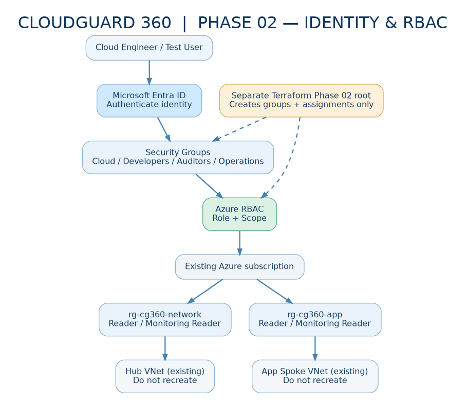

# CLOUDGUARD 360 — Phase 02: Microsoft Entra ID & Azure RBAC



## Start here

1. Read **[terraform.md](terraform.md)** for a complete, beginner-friendly, exact-click and exact-command English guide.
2. Open **[index.html](index.html)** locally for an animated offline walkthrough with copy-code controls and a progress checklist.
3. Follow the guide's **read-only audit**, then **Release A (4 Entra security groups)** and **Release B (7 optional read-only Azure RBAC assignments)**.
4. Do **not** overwrite or delete your original **Phase 01 network Terraform** folder.

### Folder structure
- `terraform/` — isolated Terraform root and state (no VNets or RG creation)
- `scripts/` — preflight, audit, verification and plan safety-check scripts
- `assets/` — four original professional architecture/navigation diagrams as PNG, editable SVG and DOT source
- `evidence/` — local assessment notes (do not publish sensitive evidence)
- `terraform.md` — complete illustrated step-by-step documentation
- `index.html` — animated interactive offline course

### Three-command start (after reading upload instructions)
```bash
cd "$HOME/clouddrive/cloudguard360/CloudGuard360_Phase02_Identity_RBAC/terraform"
export ARM_SUBSCRIPTION_ID="$(az account show --query id -o tsv)"
bash ../scripts/preflight.sh
```

### Safety defaults
- `enable_role_assignments = false` (group creation only at first)
- `enable_app_contributor = false` (no broad write privileges)
- `demo_member_object_id = ""` (no user added automatically)

**Use a saved plan; review it before apply.** Creation of Entra groups and RBAC assignments requires distinct directory and resource-management permissions. No Azure infrastructure has been deployed as part of generating this package.
