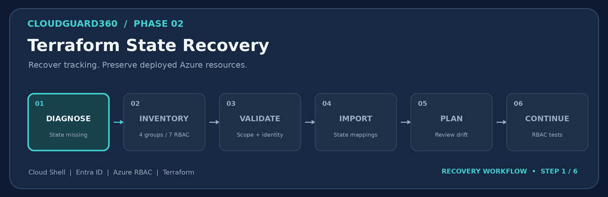
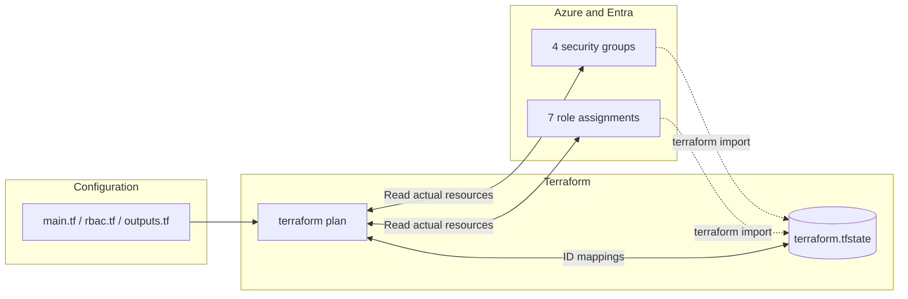
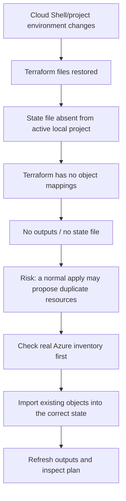
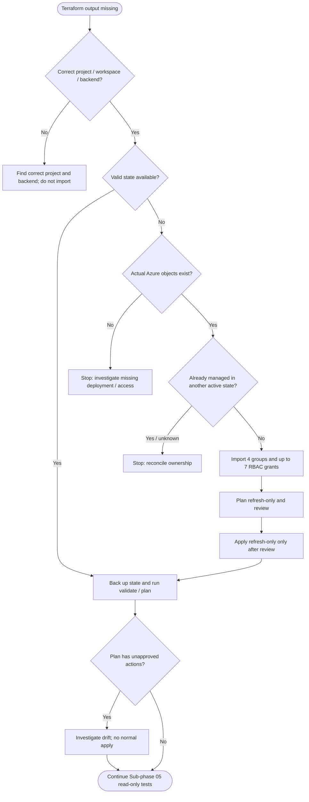
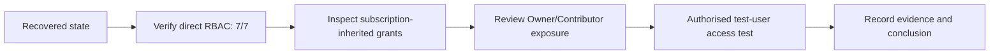

<div align="center">

# CloudGuard360 — Terraform State Recovery & Diagnostics

**Phase 02 · Microsoft Entra ID · Azure RBAC · Azure Cloud Shell**



**Recovery runbook** · **RCA / post-incident review** · **Safe Bash automation** · **Operational handover**

</div>

> [!IMPORTANT]
> **Start here:** Azure resources and Terraform state are **not the same thing**. Recreating missing state is a management-recovery task, **not** permission to redeploy infrastructure. This guide never authorises a normal `terraform apply` without inspecting its full plan.

> [!NOTE]
> **Current documented outcome (8 November 2026):** four Entra security groups and seven Azure RBAC assignments were found and imported/tracked; `terraform output rbac_assignment_count` returned **`7`**. The last shared plan still proposed **four in-place updates** for `prevent_duplicate_names = false -> true`; therefore **no-drift / zero-change readiness has not been demonstrated**. The next activity is **Phase 02, Sub-phase 05/08 — RBAC inheritance and least-privilege tests**.

## Navigation

1. [Executive summary](#1-executive-summary)
2. [How Terraform state works](#2-how-terraform-state-works)
3. [Incident facts and root-cause analysis](#3-incident-facts-and-root-cause-analysis)
4. [Recovery decision tree](#4-recovery-decision-tree)
5. [Repository structure and prerequisites](#5-repository-structure-and-prerequisites)
6. [Quick restart after Cloud Shell disconnects](#6-quick-restart-after-cloud-shell-disconnects)
7. [Read-only diagnosis](#7-read-only-diagnosis)
8. [Controlled state recovery](#8-controlled-state-recovery)
9. [Single recovery script — complete source](#9-single-recovery-script--complete-source)
10. [Acceptance tests and exit criteria](#10-acceptance-tests-and-exit-criteria)
11. [Troubleshooting playbook](#11-troubleshooting-playbook)
12. [Interpreting the remaining Terraform drift](#12-interpreting-the-remaining-terraform-drift)
13. [Security, backup and future prevention](#13-security-backup-and-future-prevention)
14. [Handover to Sub-phase 05/08](#14-handover-to-sub-phase-0508)
15. [References and maintenance](#15-references-and-maintenance)

---

## 1. Executive summary

| Dimension | Incident evidence | Meaning |
|:--|:--|:--|
| **Service / lab** | CloudGuard360, Phase 02 | Microsoft Entra groups + Azure RBAC |
| **Observed symptom** | `No state file was found!` and `Warning: No outputs found` | Terraform could not see its prior managed-object mappings |
| **Azure infrastructure** | `rg-cg360-app` and `rg-cg360-network` found | Phase 01 resource groups were still present |
| **Entra security groups** | **4/4** found in Azure | Re-creation of these groups was unnecessary |
| **Azure RBAC** | **7/7** expected assignments found | Re-creating role grants was unnecessary |
| **Local project copy** | `.tf` files and `terraform.tfvars.example` available | Configuration had been restored |
| **Missing recovery material** | No `terraform.tfstate` found in searched home; supplied ZIP contained no state | Configuration backup was not a state backup |
| **Recovery outcome** | Groups and role assignments imported into local state; output **7** | Terraform tracking was recovered |
| **Residual discrepancy** | Four `azuread_group` entries show `prevent_duplicate_names: false -> true` | Review needed before a normal apply |

### Executive decision

**Proceed to read-only Phase 02 RBAC testing.** Preserve the recovered state. Do **not** run an unreviewed normal `terraform apply`, `terraform destroy`, `terraform state rm`, or a fresh deployment because a previous `plan` is not empty.

### Operational success criteria

- [x] Azure subscription reachable; two target resource groups found.
- [x] Four expected Entra groups identified.
- [x] Seven expected resource-group role assignments identified.
- [x] Terraform output `rbac_assignment_count = 7` observed.
- [ ] Entire current plan reviewed with zero **unapproved** changes.
- [ ] Inherited privileges and user-effective access tested in Sub-phase 05.
- [ ] Long-term, access-controlled remote backend with state locking configured.

---

## 2. How Terraform state works

**Configuration (`*.tf`)** says what you want to manage. **Azure** holds the actual groups and role assignments. **State (`terraform.tfstate`)** maps Terraform resource addresses to real Azure object identifiers. A missing state file does **not** imply missing Azure resources.



### Three distinct notions

| Concept | Example | What its loss means |
|:--|:--|:--|
| Code | `resource "azuread_group" "lab"` | Terraform no longer has the desired declaration |
| Real resource | `CG360-Developers` in Entra | Identity still exists unless explicitly deleted |
| State mapping | `azuread_group.lab["developers"]` → Entra object ID | Terraform no longer recognises that existing identity as managed |

`terraform import ADDRESS ID` adds an **existing** resource to the state. It does not re-create the Azure object. `terraform plan` then reconciles code, state, and real infrastructure. An import must never attach an object already managed by another active Terraform state.

---

## 3. Incident facts and root-cause analysis

### 3.1 Incident timeline — evidence-based reconstruction

| Sequence | Observed artefact | Verified conclusion |
|:--|:--|:--|
| 01 | Cloud Shell project contained `main.tf`, `rbac.tf`, `outputs.tf`, `variables.tf`, etc. | Config files were present |
| 02 | `terraform workspace show` returned `default` | Active workspace label was `default` |
| 03 | `terraform state list` returned `No state file was found!` | Active local working directory had no readable Terraform state |
| 04 | `terraform output` warned `No outputs found` | No state outputs were available |
| 05 | Search under `$HOME` returned no state; ZIP listing showed `.tf` and docs, not `.tfstate` | Neither inspected location contained a usable state copy at the time |
| 06 | Azure CLI showed the two expected resource groups, four groups, and seven roles | Actual Azure resources survived |
| 07 | Recovery imported/tracked 4 groups and 7 role assignments | State mappings could be rebuilt |
| 08 | `terraform output rbac_assignment_count` returned `7` | Output successfully refreshed or available |
| 09 | `terraform plan` proposed four `prevent_duplicate_names` changes | Recovery succeeded, but exact code-vs-provider agreement not proven |

### 3.2 Root cause: what is known vs inferred

**Confirmed immediate cause:** Terraform CLI lacked the state file for this active Phase 02 project/workspace. The checked archive included configuration but not the state.

**Likely contributing scenario (not conclusively proven):** During Cloud Shell disconnection/recreation or project restoration, the directory containing local Terraform state was not preserved alongside the configuration. The observed evidence cannot prove precisely *when*, *how*, or *by whom* the original state was lost.

**Do not claim:** an Azure outage, deletion of the Entra groups, deletion of the RBAC assignments, a compromised account, or confirmed Cloud Shell storage corruption. None is supported by the evidence.

### 3.3 Causal chain



### 3.4 Corrective actions

| Priority | Action | Owner | Evidence of closure |
|:--|:--|:--|:--|
| P0 | Preserve the **recovered** state and prevent accidental commits | Lab operator | `terraform state list`, protected backup |
| P0 | Avoid a normal apply until the residual diff is reviewed | Lab operator | Full `terraform plan` reviewed |
| P1 | Record Azure subscription, tenant, resource addresses and scopes | Lab operator | Private inventory / incident record |
| P1 | Move to a secure, versioned remote backend with locking | Cloud platform owner | Backend access and recovery test |
| P2 | Add a reconnection health-check to routine lab start | Lab operator | Successful `--diagnose` run |
| P2 | Add documented restoration exercises | Lab operator | Exercise record and rollback procedure |

---

## 4. Recovery decision tree



> [!CAUTION]
> A `terraform state list` error can be caused by a **wrong backend, wrong workspace, missing authentication or missing local state**. Do not automatically infer that all Terraform state everywhere has been deleted. This particular recovery script intentionally supports **only the known local/default Phase 02 setup**.

---

## 5. Repository structure and prerequisites

```text
CloudGuard360_Terraform_State_Recovery/
├── README.md                         # GitHub landing page (this guide)
├── Terraform_State_Recovery.md       # Same guide, named for your project
├── assets/
│   ├── terraform_state_recovery.gif  # Animated workflow
│   └── terraform_state_recovery.png  # Static fallback
└── scripts/
    └── cloudguard360_phase02_recover.sh
```

**Requirements:** Bash (Azure Cloud Shell), Azure CLI (`az`), Terraform CLI, Python 3, authenticated access to the correct Azure tenant/subscription, read permissions on resource groups/RBAC, read access to the four Entra groups, and permissions to import/read state. A documented recovery should be performed only by an authorised operator.

For the **current project**, the existing Terraform directory is:

```bash
cd ~/clouddrive/cloudguard360/CloudGuard360_Phase02_Identity_RBAC/terraform
```

Important: the script assumes the original `main.tf`, `rbac.tf`, `variables.tf`, `providers.tf`, `versions.tf`, and `outputs.tf` are already in that directory. It does not create or modify those files.

### Upload the package to Cloud Shell

1. In Azure Portal, open **Cloud Shell → Bash**.
2. Use **Manage files → Upload** (label may vary) to upload the downloaded ZIP, or place the repository files in your persistent `clouddrive`.
3. Extract the package in a convenient location (example below).
4. Run `--diagnose` before any recovery action.

```bash
mkdir -p ~/clouddrive/cloudguard360/recovery-docs
cd ~/clouddrive/cloudguard360/recovery-docs
unzip -o ~/CloudGuard360_Terraform_State_Recovery.zip
# If your uploaded ZIP was placed elsewhere, change the source path above.
```

If your file already exists within `clouddrive`, **do not needlessly extract or overwrite it**. Open the repository's `README.md` or execute its script in place.

---

## 6. Quick restart after Cloud Shell disconnects

**Use this when the recovery has already been completed** (the previously observed result was 4/4 groups, 7/7 assignments and output 7). Do not re-import everything simply because a new terminal session has begun.

```bash
# QUICK START — copy/paste after reconnecting to Azure Cloud Shell
cd ~/clouddrive/cloudguard360/CloudGuard360_Phase02_Identity_RBAC/terraform || exit 1
az account show --query '{subscription:name,id:id,tenantId:tenantId}' -o json
export ARM_SUBSCRIPTION_ID="$(az account show --query id -o tsv)"
export ARM_TENANT_ID="$(az account show --query tenantId -o tsv)"
terraform init -input=false
terraform validate
terraform workspace show
terraform state list
terraform output -raw rbac_assignment_count
terraform plan -input=false
```

**Expected:** 4 group addresses, 7 RBAC addresses, output `7`. The plan might still show the four known `prevent_duplicate_names` changes: **read and classify these; do not apply automatically**.

### Optional: run the packaged read-only diagnosis

```bash
cd ~/clouddrive/cloudguard360/recovery-docs/CloudGuard360_Terraform_State_Recovery
bash scripts/cloudguard360_phase02_recover.sh --diagnose
```

Change the path if you put the package in a different folder. `--diagnose` reads Azure and Terraform, writes only **private diagnostic files and a local state backup if state exists**; it does not perform Terraform imports or Azure mutations.

---

## 7. Read-only diagnosis

### 7.1 Confirm identity and resources

```bash
az account show --query '{name:name,id:id,tenant:tenantId}' -o json
az group exists --name rg-cg360-app
az group exists --name rg-cg360-network
az ad group list --filter "displayName eq 'CG360-Developers'" \
  --query '[].{name:displayName,id:id,security:securityEnabled}' -o json
```

A successful login **does not guarantee** access to Microsoft Entra data or RBAC enumeration; permissions may still be insufficient. An empty list could indicate genuinely missing resources *or* inadequate visibility. Treat CLI errors as errors, not proof of absence.

### 7.2 Inspect configuration, workspace and state

```bash
cd ~/clouddrive/cloudguard360/CloudGuard360_Phase02_Identity_RBAC/terraform
pwd
ls -la
terraform workspace show
terraform state list
terraform output

grep -Rn 'rbac_assignment_count' --include='*.tf' .
grep -RniE 'backend[[:space:]]+"|cloud[[:space:]]*\{' --include='*.tf' . || true
```

### 7.3 Search for recoverable state snapshots

```bash
find "$HOME" -type f \
  \( -name terraform.tfstate -o -name terraform.tfstate.backup \
     -o -name '*.tfstate' \) -print 2>/dev/null | head -100

unzip -Z1 ~/old-home-restored/CloudGuard360_Phase02_Identity_RBAC.zip \
  | grep -Ei '(^|/)(terraform\.tfstate(\.backup)?|.*\.tfstate)$' || true
```

Do not assume that finding *any* `terraform.tfstate` means it belongs to Phase 02. Check workspace, backend, resource addresses, tenant and subscription before using a candidate backup. **Never manually merge JSON state files.**

---

## 8. Controlled state recovery

Recovery is a **controlled change to Terraform state**. It must not be conflated with resource provisioning. HashiCorp expects each real-world object to be managed under **one** Terraform state address.

### Stage 0 — Ownership and context checks

1. Verify the correct subscription and tenant, and the `default` workspace.
2. Verify that no remote backend or another operator's active state manages the same four groups or seven assignments.
3. Confirm the two target resource-group names, four group IDs and seven RBAC resource IDs.
4. Preserve any existing local state backup; do not modify or remove an existing known-good state.
5. Review `terraform.tfvars`: RBAC recovery uses `enable_role_assignments = true`, `enable_app_contributor = false`, and an empty optional demo member ID.

### Stage 1 — Diagnose only

```bash
bash scripts/cloudguard360_phase02_recover.sh --diagnose
```

This lists group identities, reads direct resource-group role assignments, and reports missing state. **No Azure mutations or imports are executed.**

### Stage 2 — Import the actual existing objects into the state

```bash
bash scripts/cloudguard360_phase02_recover.sh --recover
```

The script asks you to type `RECOVER`. It creates `terraform.tfvars` **only if absent**, never overwrites an existing one, backs up a local state if present, and skips addresses already in state. If a group is ambiguous or any of the seven expected RBAC assignments is missing, it **stops before recovery is declared complete**.

### Stage 3 — Refresh state outputs, but not infrastructure

```bash
# Review the proposed state-only changes FIRST:
terraform plan -refresh-only

# If the state-only changes are correct, approve interactively:
terraform apply -refresh-only

terraform output -raw rbac_assignment_count
```

`-refresh-only` refreshes **state and outputs**, not deployed Azure resources; still review the proposed changes, because a misconfigured provider can make valid resources appear absent. **The recovery script intentionally does not auto-approve refresh-only.**

### Stage 4 — Inspect desired-vs-actual differences

```bash
terraform validate
terraform state list
terraform plan -input=false -detailed-exitcode
```

For `terraform plan -detailed-exitcode`, exit code `0` means no changes, `1` means error and `2` means changes are proposed. **Exit code 2 is not automatically a failure**, but it requires evaluation.

---

## 9. Single recovery script — complete source

The complete, versionable script is at [`scripts/cloudguard360_phase02_recover.sh`](scripts/cloudguard360_phase02_recover.sh). It is deliberately more conservative than the initial incident command: *diagnosis is the default mode, import requires explicit confirmation, and refresh-only apply is never auto-approved.*

<details>
<summary><strong>Expand the complete Bash source (copy/paste ready)</strong></summary>

```bash
#!/usr/bin/env bash
# CloudGuard360 / Phase 02 — safe, repeatable state diagnosis and recovery.
# Modes: --diagnose (default, no Terraform state changes), --recover (imports to state ONLY).
# No 'terraform apply' or Azure resource mutations are performed by this script.
set -Eeuo pipefail
umask 077

MODE="${1:---diagnose}"
case "$MODE" in
  --diagnose|--recover) ;;
  -h|--help)
    printf 'Usage: bash %s [--diagnose|--recover]\n' "$0"
    exit 0 ;;
  *) printf 'Invalid mode: %s\n' "$MODE" >&2; exit 2 ;;
esac

BASE="${CG360_BASE:-$HOME/clouddrive/cloudguard360}"
PROJECT="${CG360_PROJECT:-$BASE/CloudGuard360_Phase02_Identity_RBAC/terraform}"
PRIVATE="$BASE/.phase02-recovery-private"
STAMP="$(date -u +%Y%m%dT%H%M%SZ)"

info() { printf '\n\033[1;36m== %s ==\033[0m\n' "$*"; }
warn() { printf 'REVIEW: %s\n' "$*" >&2; }
fail() { printf 'STOP: %s\n' "$*" >&2; exit 1; }
trap 'printf "Stopped at line %s. Inspect output; do not run terraform apply blindly.\n" "$LINENO" >&2' ERR

for cmd in az terraform python3 grep; do
  command -v "$cmd" >/dev/null 2>&1 || fail "Required command not found: $cmd"
done
[[ -d "$PROJECT" ]] || fail "Terraform project not found: $PROJECT"
cd "$PROJECT"

info "01 / Project and Azure context"
[[ -f main.tf && -f rbac.tf && -f outputs.tf && -f variables.tf ]] || fail "Missing required .tf files"
SUBSCRIPTION_ID="$(az account show --query id -o tsv)" || fail "Please sign in with 'az login'"
TENANT_ID="$(az account show --query tenantId -o tsv)"
export ARM_SUBSCRIPTION_ID="$SUBSCRIPTION_ID" ARM_TENANT_ID="$TENANT_ID"
printf 'Project: %s\nSubscription: %s\nTenant: %s\n' "$PROJECT" "$SUBSCRIPTION_ID" "$TENANT_ID"

# Optional stricter pinning before recovery; never guess or silently switch subscriptions.
if [[ -n "${CG360_EXPECTED_SUBSCRIPTION_ID:-}" ]]; then
  [[ "$SUBSCRIPTION_ID" == "$CG360_EXPECTED_SUBSCRIPTION_ID" ]] || fail "Wrong subscription"
fi
if [[ -n "${CG360_EXPECTED_TENANT_ID:-}" ]]; then
  [[ "$TENANT_ID" == "$CG360_EXPECTED_TENANT_ID" ]] || fail "Wrong tenant"
fi

# This runbook is specifically for the local, default workspace of Phase 02.
# Do not import into a remote backend or an unexpected workspace.
if grep -Eq 'backend[[:space:]]+"|^[[:space:]]*cloud[[:space:]]*\{' ./*.tf; then
  fail "Remote backend/cloud configuration detected. Inspect and recover that backend instead."
fi

info "02 / Terraform initialization and workspace"
terraform init -input=false -no-color >/dev/null
terraform validate -no-color
WORKSPACE="$(terraform workspace show)"
[[ "$WORKSPACE" == default ]] || fail "Unexpected Terraform workspace '$WORKSPACE'"
printf 'Workspace: %s\n' "$WORKSPACE"

if [[ -f terraform.tfvars ]]; then
  printf 'terraform.tfvars: found (will not overwrite)\n'
else
  warn 'terraform.tfvars missing'
fi

info "03 / Phase 01 Resource Groups (read only)"
for rg in rg-cg360-app rg-cg360-network; do
  [[ "$(az group exists --name "$rg")" == true ]] || fail "Resource group not found: $rg"
  printf 'OK %s\n' "$rg"
done

info "04 / Existing Entra groups (read only)"
declare -a GROUP_KEYS=(cloud_engineers developers security_auditors operations)
declare -a GROUP_NAMES=(CG360-Cloud-Engineers CG360-Developers CG360-Security-Auditors CG360-Operations)
declare -A GROUP_IDS=()
for i in "${!GROUP_KEYS[@]}"; do
  key="${GROUP_KEYS[$i]}"; name="${GROUP_NAMES[$i]}"
  # Exact display-name filter; reject missing/duplicate results or non-security groups.
  payload="$(az ad group list --filter "displayName eq '$name'" -o json)" || fail "Entra query failed for $name"
  id="$(python3 -c '
import json,sys
name=sys.argv[1]
a=json.load(sys.stdin)
a=[x for x in a if x.get("displayName")==name and x.get("securityEnabled") is True]
if len(a)!=1: sys.exit("Expected exactly one security group: %s; got %d"%(name,len(a)))
print(a[0]["id"])
' "$name" <<< "$payload")" || fail "Ambiguous or invalid Entra group: $name"
  GROUP_IDS["$key"]="$id"
  printf 'OK %-27s object=%s\n' "$name" "$id"
done

info "05 / RBAC exact-scope inventory (read only)"
mkdir -p "$PRIVATE"
chmod 700 "$PRIVATE" 2>/dev/null || true
NET_SCOPE="$(az group show -n rg-cg360-network --query id -o tsv)"
APP_SCOPE="$(az group show -n rg-cg360-app --query id -o tsv)"
AZ_ARGS=(--all --fill-principal-name false --fill-role-definition-name false -o json)
az role assignment list --scope "$NET_SCOPE" "${AZ_ARGS[@]}" > "$PRIVATE/network-rbac.json" || fail "Cannot read network RBAC"
az role assignment list --scope "$APP_SCOPE" "${AZ_ARGS[@]}" > "$PRIVATE/app-rbac.json" || fail "Cannot read app RBAC"

# Inventory expected pairs using stable built-in Azure role definition GUIDs.
{
  printf 'cloud_engineers\t%s\n' "${GROUP_IDS[cloud_engineers]}"
  printf 'developers\t%s\n' "${GROUP_IDS[developers]}"
  printf 'security_auditors\t%s\n' "${GROUP_IDS[security_auditors]}"
  printf 'operations\t%s\n' "${GROUP_IDS[operations]}"
} > "$PRIVATE/groups.tsv"

python3 - "$PRIVATE/groups.tsv" "$PRIVATE/network-rbac.json" "$PRIVATE/app-rbac.json" "$NET_SCOPE" "$APP_SCOPE" > "$PRIVATE/expected-rbac.tsv" <<'PY'
import json,sys
ids_file, net_file, app_file, net_scope, app_scope = sys.argv[1:]
with open(ids_file,encoding='utf-8') as f:
    ids=dict(line.strip().split('\t',1) for line in f if line.strip())
with open(net_file,encoding='utf-8') as f: net=json.load(f)
with open(app_file,encoding='utf-8') as f: app=json.load(f)
roles={
    'Reader':'acdd72a7-3385-48ef-bd42-f606fba81ae7',
    'Monitoring Reader':'43d0d8ad-25c7-4714-9337-8ba259a9fe05'
}
expected=[
    ('engineer_network_reader','cloud_engineers',net_scope,'Reader',net),
    ('engineer_app_reader','cloud_engineers',app_scope,'Reader',app),
    ('developer_app_reader','developers',app_scope,'Reader',app),
    ('auditor_network_reader','security_auditors',net_scope,'Reader',net),
    ('auditor_app_reader','security_auditors',app_scope,'Reader',app),
    ('ops_network_monitoring','operations',net_scope,'Monitoring Reader',net),
    ('ops_app_monitoring','operations',app_scope,'Monitoring Reader',app)
]
for key, group, scope, role, assignments in expected:
    matches=[a for a in assignments
             if str(a.get('principalId','')).lower()==ids[group].lower()
             and str(a.get('scope','')).lower()==scope.lower()
             and str(a.get('roleDefinitionId','')).lower().endswith('/'+roles[role])]
    if len(matches)>1: sys.exit('Duplicate direct role assignments: '+key)
    assignment_id=(matches[0].get('id') or '') if matches else 'ABSENT'
    if matches and '/providers/microsoft.authorization/roleassignments/' not in assignment_id.lower():
        sys.exit('Unrecognised role-assignment ID for '+key)
    print(key+'\t'+assignment_id)
PY

FOUND=0; MISSING=0
while IFS=$'\t' read -r key assignment_id; do
  if [[ "$assignment_id" == ABSENT ]]; then
    printf 'MISSING %-29s\n' "$key"
    MISSING=$((MISSING+1))
  else
    printf 'FOUND   %-29s\n' "$key"
    FOUND=$((FOUND+1))
  fi
done < "$PRIVATE/expected-rbac.tsv"
printf 'RBAC exact matches found: %d/7; missing: %d/7\n' "$FOUND" "$MISSING"

info "06 / Terraform state status"
if [[ -f terraform.tfstate ]]; then
  cp -p terraform.tfstate "$PRIVATE/terraform.tfstate.precheck.$STAMP"
  printf 'State backup saved privately\n'
fi
if STATE_LIST="$(terraform state list 2>&1)"; then
  printf '%s\n' "$STATE_LIST" | sed '/^$/d'
else
  [[ ! -f terraform.tfstate ]] || fail "State exists but cannot be read: $STATE_LIST"
  STATE_LIST=""
  warn 'No readable local Terraform state yet'
fi

if [[ "$MODE" == --diagnose ]]; then
  info "DIAGNOSIS COMPLETE: infrastructure unchanged, state unchanged"
  printf 'To recover missing state addresses, first verify that no other active Terraform state owns these resources.\n'
  printf 'Then run: bash %q --recover\n' "$0"
  exit 0
fi

info "07 / Explicit recovery approval"
if [[ ! -f terraform.tfvars ]]; then
  cat > terraform.tfvars <<'TFVARS'
prefix                  = "CG360"
app_resource_group      = "rg-cg360-app"
network_resource_group  = "rg-cg360-network"
enable_role_assignments = true
enable_app_contributor  = false
demo_member_object_id   = ""
TFVARS
  chmod 600 terraform.tfvars 2>/dev/null || true
  printf 'Created conservative terraform.tfvars for seven Reader/Monitoring Reader roles\n'
else
  grep -Eq '^[[:space:]]*enable_role_assignments[[:space:]]*=[[:space:]]*true([[:space:]]*(#.*)?)?$' terraform.tfvars ||
    fail 'Existing tfvars must explicitly enable_role_assignments = true; no import performed'
  if grep -Eq '^[[:space:]]*enable_app_contributor[[:space:]]*=[[:space:]]*true' terraform.tfvars; then
    fail 'Contributor escalation detected. Review configuration manually.'
  fi
fi

printf 'Recovery will WRITE ONLY Terraform state and (if absent) terraform.tfvars.\n'
printf 'It will NOT change Azure resources. Confirm ownership and subscription.\n'
read -r -p 'Type RECOVER to approve local state imports: ' CONFIRM
[[ "$CONFIRM" == RECOVER ]] || fail 'Recovery cancelled'

# The seven role assignments are intentionally required to prevent a half-managed
# state from being treated as ready. Existing partial imports remain idempotent.
[[ "$FOUND" -eq 7 ]] || fail "Only $FOUND/7 assignments exist. Diagnose missing permissions first."

STATE_LIST="$(terraform state list 2>/dev/null || true)"
for key in "${GROUP_KEYS[@]}"; do
  addr="azuread_group.lab[\"$key\"]"
  if grep -Fqx "$addr" <<< "$STATE_LIST"; then
    printf 'SKIP  %-35s already in state\n' "$addr"
  else
    terraform import -input=false -no-color "$addr" "/groups/${GROUP_IDS[$key]}"
    STATE_LIST="$(terraform state list)"
  fi
done

while IFS=$'\t' read -r key assignment_id; do
  addr="azurerm_role_assignment.lab[\"$key\"]"
  if grep -Fqx "$addr" <<< "$STATE_LIST"; then
    printf 'SKIP  %-45s already in state\n' "$addr"
  else
    terraform import -input=false -no-color "$addr" "$assignment_id"
    STATE_LIST="$(terraform state list)"
  fi
done < "$PRIVATE/expected-rbac.tsv"

info "08 / Refresh-only PREVIEW (no apply)"
terraform plan -refresh-only -input=false -no-color
printf '\nTo review and write refreshed outputs to state, run MANUALLY:\n'
printf '  terraform apply -refresh-only\n'
printf 'Then run terraform output rbac_assignment_count and terraform plan.\n'
printf 'Do not apply a normal plan before reviewing any drift.\n'
info "RECOVERY IMPORTS COMPLETE"
```

</details>

**Safety contract:** no `az ... create`, `az ... delete`, normal `terraform apply`, or `terraform destroy` occurs in this script. The `--recover` option **does modify Terraform state**, so ensure the state owner has authorised the recovery.

---

## 10. Acceptance tests and exit criteria

### 10.1 Machine-checkable Terraform inventory

```bash
cd ~/clouddrive/cloudguard360/CloudGuard360_Phase02_Identity_RBAC/terraform

terraform validate
terraform state list | grep '^azuread_group.lab\[' | wc -l
terraform state list | grep '^azurerm_role_assignment.lab\[' | wc -l
terraform output -raw rbac_assignment_count
```

Target counts are `4`, `7`, `7`. These counts demonstrate *tracking*, **not** least-privilege compliance or zero drift.

### 10.2 Review the full plan

```bash
# Avoid uploading state or plans to public GitHub.
terraform plan -input=false -no-color -detailed-exitcode
printf 'Terraform plan exit code: %s\n' "$?"
```

| Exit code | Interpretation | Operator action |
|:--:|:--|:--|
| **0** | No proposed changes | Move to read-only RBAC tests |
| **1** | Plan failed | Diagnose auth, state, provider, syntax, or permissions |
| **2** | Planned differences | Read **all** changes; do not normal-apply without approval |

### 10.3 Evidence and approval checklist

- [ ] Correct subscription, tenant and default workspace recorded privately.
- [ ] 4/4 Entra groups and 7/7 exact-scope RBAC assignments found.
- [ ] `terraform output -raw rbac_assignment_count` returns 7.
- [ ] No unanticipated resource create, delete or replacement in the full plan.
- [ ] Known `prevent_duplicate_names` in-place diff classified and documented.
- [ ] Inherited role grants assessed separately.
- [ ] Optional test user has **authorised** access for effective-permissions testing.
- [ ] State backup stored securely outside the public repository.

---

## 11. Troubleshooting playbook

| Symptom | Likely explanation | Safe first response |
|:--|:--|:--|
| `Warning: No outputs found` | No root outputs yet in current state | Inspect `terraform state list`; locate correct backend/workspace |
| `No state file was found!` | Wrong directory or state missing | Inspect `pwd`, backend, workspace and backups |
| `terraform.tfvars` absent | Only sample values available | Review defaults; create conservative values **only when authorised** |
| `az account show` fails | Session expired | Sign in to Azure; verify current subscription |
| `az ad group list` fails | Microsoft Graph/Entra read permission or CLI issue | Resolve permissions; do not infer group deletion |
| Imported group already exists in state | Recovery was previously executed | Skip import; verify address-to-ID mapping |
| Multiple groups with same display name | Ambiguous identity | Stop; identify exact object ID with directory owner |
| Missing one RBAC role | Grant not present or insufficient visibility | Stop; investigate scope/role before remediation |
| Import reports invalid ID | Wrong provider resource ID syntax | Check `/groups/<object-id>` or full `/subscriptions/.../roleAssignments/...` |
| `rbac_assignment_count = 0` after a new import | Outputs not yet persisted / roles disabled | Verify role addresses and `terraform plan -refresh-only` |
| `plan` returns 2 | Differences exist | Review proposed actions; normal apply is not automatic |
| `prevent_duplicate_names false -> true` | Imported provider state does not match configured argument | Classify reviewed in-place difference; see next section |
| Terraform providers cannot initialise | Network or version constraints | Check `terraform init` error and `versions.tf` |
| State resides in another backend | Actual state may be remote | Stop local import; restore correct backend config |
| Cloud Shell reconnect loses exported ARM vars | Shell environment resets | Re-export `ARM_SUBSCRIPTION_ID` and `ARM_TENANT_ID` |

### Common diagnostic command reference

<details>
<summary><strong>Show precise commands</strong></summary>

```bash
pwd
type az terraform python3
az account show --query '{name:name,id:id,tenant:tenantId}' -o json
terraform version
terraform workspace show
terraform validate
terraform state list
terraform output -json
terraform state show 'azuread_group.lab["developers"]'
terraform state show 'azurerm_role_assignment.lab["developer_app_reader"]'
terraform plan -refresh-only
terraform plan -detailed-exitcode
```

`terraform output -json`, `terraform state show`, and saved plans may reveal infrastructure metadata or sensitive output values. **Store diagnostic logs privately and redact before sharing.**

</details>

---

## 12. Interpreting the remaining Terraform drift

The post-recovery plan showed four lines similar to:

```diff
# azuread_group.lab["developers"] will be updated in-place
~ resource "azuread_group" "lab" {
-   prevent_duplicate_names = false
+   prevent_duplicate_names = true
}
```

**Meaning:** the configuration requests Terraform's **group-name duplicate-prevention setting**; the imported provider state records a different value. It is not, by itself, evidence that Azure group membership or RBAC privileges changed. It **does** mean the last reported normal plan was *not empty*.

**Recommended handling:** keep `prevent_duplicate_names = true` in the current configuration while you inspect the full plan. Do not set it to `false` merely to get a green dashboard, and do not apply the four updates automatically. If an authorised maintainer accepts the setting, document the decision and the Terraform/provider behaviour observed in the next plan. The RBAC read-only tests can proceed independently.

### Current baseline RBAC matrix

| Key | Entra group | Scope | Planned role |
|:--|:--|:--|:--|
| `engineer_network_reader` | Cloud Engineers | `rg-cg360-network` | Reader |
| `engineer_app_reader` | Cloud Engineers | `rg-cg360-app` | Reader |
| `developer_app_reader` | Developers | `rg-cg360-app` | Reader |
| `auditor_network_reader` | Security Auditors | `rg-cg360-network` | Reader |
| `auditor_app_reader` | Security Auditors | `rg-cg360-app` | Reader |
| `ops_network_monitoring` | Operations | `rg-cg360-network` | Monitoring Reader |
| `ops_app_monitoring` | Operations | `rg-cg360-app` | Monitoring Reader |

If `enable_app_contributor = true`, the intended Cloud Engineers app role is **Contributor** instead of Reader: this is an explicit elevation and requires a separate authorisation and revised import matching logic. The packaged script intentionally refuses such a configuration.

---

## 13. Security, backup and future prevention

### 13.1 Protect state, logs, and private variables

Terraform state and plan artifacts can contain sensitive values even if a specific output is marked `sensitive = true`. Restrict access, encrypt backups and **never commit local states to GitHub**.

Add or verify the project `.gitignore`:

```gitignore
**/.terraform/
**/terraform.tfstate
**/terraform.tfstate.*
**/*.tfstate
**/*.tfstate.*
**/*.tfplan
**/terraform.tfvars
**/*.auto.tfvars
**/.phase02-recovery-private/
**/.phase02-private/
**/crash.log
**/crash.*.log
```

Keep `terraform.tfvars.example` in source control (with sample placeholders, not secrets). Retain a securely controlled copy of any state file. **Never** place `state`, private group inventory, CLI auth material or service credentials in a publicly downloadable ZIP.

### 13.2 Recommended next improvement: remote backend

For repeatable lab operations, move the state to an **Azure Blob Storage backend** with suitable access controls, encryption, operational backup/versioning, and backend locking. The state-storage account should have independent lifecycle and protection from the infrastructure it manages. This guide intentionally **does not automatically create or migrate a backend**.

Conceptual backend configuration (**replace placeholders and approve migration separately**):

```hcl
terraform {
  backend "azurerm" {
    resource_group_name  = "<state-rg>"
    storage_account_name = "<unique_state_storage_account>"
    container_name       = "tfstate"
    key                  = "cloudguard360/phase02/terraform.tfstate"
    use_azuread_auth     = true
  }
}
```

Backend authentication and migration depend on your Terraform/AzureRM versions and identity setup. After reviewing the official instructions, back up the current state and plan an explicit `terraform init -migrate-state` operation. Do not attempt migration from an uncertain or partial state.

### 13.3 Long-term operational controls

- Run the **diagnostic mode** whenever Cloud Shell is rebuilt or reconnected.
- Verify `pwd`, subscription, tenant, workspace and backend before every state operation.
- Use distinct state paths for **Phase 01 vs Phase 02**; do not import a Phase 02 role into Phase 01 state.
- Prefer locked, access-controlled remote state and periodic recovery exercises.
- Maintain evidence of expected group IDs, role definition IDs, scopes and change approvals in a private audit record.
- Restrict Terraform `apply` to reviewed plans and an authorised operator.
- Before exposing diagnostic output, remove tenant IDs, subscription IDs, user IDs, any secrets and unnecessary account metadata.

---

## 14. Handover to Sub-phase 05/08

**Sub-phase 05 objective:** test actual RBAC assignments, inheritance and least privilege, not simply count imported resources.



### Safe read-only inheritance check

```bash
cd ~/clouddrive/cloudguard360/CloudGuard360_Phase02_Identity_RBAC/terraform

# Principal ID is read from the EXISTING Terraform output; do not print it publicly.
DEV_GROUP_ID="$(terraform output -json security_group_ids | python3 -c 'import json,sys; print(json.load(sys.stdin)["developers"])')"
APP_RG_ID="$(az group show -n rg-cg360-app --query id -o tsv)"

# Direct + inherited RBAC, including parent-scope assignments:
az role assignment list \
  --assignee-object-id "$DEV_GROUP_ID" \
  --scope "$APP_RG_ID" \
  --all --include-inherited \
  --query '[].{role:roleDefinitionName,scope:scope}' -o table
```

`--include-inherited` reveals relevant parent-scope grants; additional access can arise from other memberships, deny assignments or resource-specific mechanisms. A **real least-privilege verdict requires reviewing the permission model and, where authorised, testing effective access with a designated user**.

### Handover decision

**Operationally ready for the next read-only module** if Azure identity is correct and you can inspect the seven expected assignments. **Not yet production-certified / zero-drift verified** until you resolve or approve the four residual plan differences and execute least-privilege testing.

---

## 15. References and maintenance

Official references used to design this runbook:

- HashiCorp, [Terraform state overview](https://developer.hashicorp.com/terraform/language/state).
- HashiCorp, [Import existing resources](https://docs.hashicorp.com/terraform/cli/import/usage).
- HashiCorp, [State commands](https://developer.hashicorp.com/terraform/cli/commands/state).
- HashiCorp, [Plan / detailed exit codes](https://developer.hashicorp.com/terraform/cli/commands/plan).
- HashiCorp, [Refresh-only state reconciliation](https://developer.hashicorp.com/terraform/tutorials/state/refresh).
- HashiCorp, [Sensitive data in state](https://developer.hashicorp.com/terraform/language/manage-sensitive-data).
- HashiCorp Registry, [`azuread_group` import and name uniqueness](https://registry.terraform.io/providers/hashicorp/azuread/latest/docs/resources/group.html).
- HashiCorp Registry, [`azurerm_role_assignment` import](https://registry.terraform.io/providers/hashicorp/azurerm/latest/docs/resources/role_assignment.html).
- Microsoft Learn, [List Azure RBAC role assignments with Azure CLI](https://learn.microsoft.com/en-us/azure/role-based-access-control/role-assignments-list-cli).

**Document control:** CloudGuard360 Phase 02 / Terraform State Recovery · Version 1.0 · 8 November 2026 · Status: **recovered with a known plan discrepancy**.

> **Maintainer's final rule:** *First understand the active state. Then verify actual Azure resources. Import only objects with confirmed ownership. Review the full plan before applying any desired change.*
