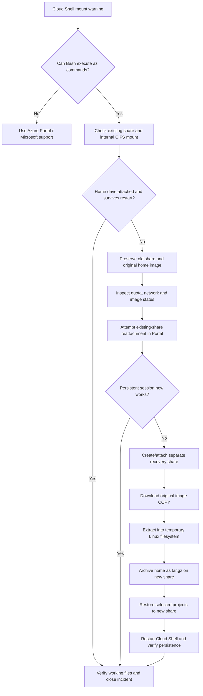

# Azure Cloud Shell — Root Cause Analysis & Recovery Runbook

> **Incident:** Persistent Azure Files mount failure and recovery of the Cloud Shell home directory  
> **Observed:** 7 November 2026 · **Service:** Azure Cloud Shell (Bash) · **Region:** North Europe  
> **Document type:** RCA + reusable recovery playbook · **Version:** 1.0  
> **Status:** 🟡 **Recovery in progress / persistence awaiting post-restart proof**

[](https://learn.microsoft.com/azure/cloud-shell/overview)
[](#safety-first)
[](#root-cause-analysis)

---

## Executive summary / Synthèse exécutive

**Incident.** An Azure Cloud Shell session displayed **“Failed to mount the Azure file share. Your cloud drive won't be available.”** The user was placed in an **ephemeral session**, and `~/clouddrive` was missing. Important CloudGuard360/Terraform work appeared to be inaccessible.

**What the evidence proved.** The Azure subscription was enabled, its storage account was provisioned, and the *original Azure Files share was actually mounted internally* at `/usr/csuser/clouddrive` via SMB/CIFS. However, the expected user-facing drive at `/home/net/clouddrive` and persistent `$HOME` were not attached. The original `.cloudconsole/acc_net.img` was present (about **5 GiB**); a downloaded copy identified itself as an **ext2 filesystem with an unclean/error state**. The original share consumed **5,920,580,608 bytes (~5.51 GiB) out of 6 GiB (~92%)**.

**Recovery approach.** Preserve the original share and image; optionally increase share quota; attach a **fresh recovery share/home image** using the Azure Portal; extract files from a **copy** of the original image; package them into a `tar.gz` archive to avoid SMB symlink incompatibilities; restore important project files into persistent `~/clouddrive`; test across a new session.

**Outcome observed in this case.** The restored directory `~/old-home-restored` contained `CloudGuard360_Phase02_Identity_RBAC.zip`, `CloudGuard360_Terraform_Azure_Network_Starter_v2.zip`, `code/`, and `Microsoft/`. **No post-restart persistence output was supplied**, so end-to-end closure must remain **unverified** until the acceptance checks below pass.

**Root cause statement (appropriately qualified).** The immediate failure was **Cloud Shell's inability to complete the user-home/drive attachment despite an operational SMB share mount**. A defective or unclean original home image and limited free space are **plausible contributing factors**, not independently confirmed causes. Cloud Shell service-side logs would be required to distinguish them conclusively.

| Executive question | Answer |
|---|---|
| **Was Azure Storage down?** | No evidence of a storage-account outage; resource state was `Succeeded`, and an SMB mount existed. |
| **Were the original project files necessarily deleted?** | No. An old home image existed and identifiable CloudGuard360 artifacts were recovered. |
| **Was the issue simply DNS/firewall?** | Unlikely based on available evidence: DNS resolved, firewall default was `Allow`, SMB was mounted. |
| **Is quota the confirmed cause?** | **No.** At ~92%, it warranted remediation/monitoring but was not proven causal. |
| **What closes the incident?** | Project files readable from the recovery share **after** Cloud Shell has been closed and reopened, plus confirmation that the original recovery backup remains available. |

> [!IMPORTANT]
> This README contains real resource names from the incident. **Sanitise names, paths, screenshots, and any personal data before publishing to a public repository.** Never publish recovered `.azure/`, SSH keys, tokens, Terraform state files, or a full home-directory archive.

### Navigate this runbook

- [1. Environment and incident record](#1-environment-and-incident-record)
- [2. Incident evidence and RCA](#2-incident-evidence-and-rca)
- [3. Safety first](#safety-first)
- [4. Troubleshooting decision tree](#4-troubleshooting-decision-tree)
- [5. Copy/paste diagnostics](#5-copy--paste-diagnostics)
- [6. Restore persistent Cloud Shell](#6-restore-persistent-cloud-shell)
- [7. Recover the original home image](#7-recover-the-original-home-image)
- [8. Preserve and restore CloudGuard360](#8-preserve-and-restore-cloudguard360)
- [9. Persistence and integrity acceptance tests](#9-persistence-and-integrity-acceptance-tests)
- [10. Graphical recovery options](#10-graphical-recovery-options)
- [11. Error catalogue](#11-error-catalogue)
- [12. Preventive and corrective actions](#12-preventive-and-corrective-actions)
- [13. Closure checklist](#13-closure-checklist)
- [References](#references)

---

## 1. Environment and incident record

| Attribute | Observed value |
|---|---|
| Environment | Azure Cloud Shell, Bash; user `net` |
| Azure CLI | `2.91.0` |
| Subscription | `Azure subscription 1` (Enabled) |
| Resource group | `cloud-shell-storage-northeurope` |
| Storage account | `csa100320065c4fb910` |
| Storage SKU/region | `Standard_LRS` / `northeurope` |
| Original file share | `cs-net89284-gmail-com-100320065c4fb910` |
| Recovery file share | `cs-net-recovery-20261107` (created/selected during recovery; verify it exists in your subscription) |
| Original Cloud Shell home image | `.cloudconsole/acc_net.img` (~5.0 GiB) |
| Old underlying SMB mount | `/usr/csuser/clouddrive` |
| Expected user drive | `/home/net/clouddrive` |
| Known recovered items | Two CloudGuard360 ZIPs, `code/`, `Microsoft/` |
| Persistence validation | **Pending**; cannot infer from an `ls` during the same session |

### Azure Cloud Shell storage model

```text
Azure storage account: csa100320065c4fb910
└── Azure Files share: cs-net89284-gmail-com-100320065c4fb910  [ORIGINAL]
    ├── .cloudconsole/
    │   └── acc_net.img               ← virtual Linux filesystem storing old $HOME
    └── other files/folders          ← files placed directly in ~/clouddrive

Fresh Azure Files share: cs-net-recovery-20261107 [RECOVERY]
├── .cloudconsole/acc_net.img        ← NEW Cloud Shell home image: DO NOT overwrite
├── old-data-recovered/              ← archive of recovered original data
└── cloudguard360/                   ← persistent working project directory
    └── CloudGuard360_Phase02_Identity_RBAC/
        └── terraform/
```

A Cloud Shell share has **two different storage roles**: it directly exposes `~/clouddrive`, and it also contains a disk image used to persist the rest of `$HOME`. Consequently, copying an `.img` file to a new share does **not** automatically migrate the contents into the new home directory. [Microsoft Cloud Shell storage documentation](https://learn.microsoft.com/en-us/azure/cloud-shell/persisting-shell-storage).

---

## 2. Incident evidence and RCA

### Observable sequence

| Phase | Evidence | Meaning |
|---|---|---|
| 01 — Detection | `Warning: Failed to mount the Azure file share ... ephemeral` | Cloud Shell failed to deliver a persistent session. |
| 02 — User-facing failure | `ls: cannot access '/home/net/clouddrive'` | Expected drive path absent. |
| 03 — Subscription validation | Subscription `Enabled` | Subscription availability not the issue. |
| 04 — Storage configuration | Storage `Succeeded`; firewall `Allow`; `allowSharedKeyAccess: null` | No explicit disabled access setting shown; `null` is not a confirmed fault. |
| 05 — Underlying share | CIFS mount at `/usr/csuser/clouddrive` | Azure Files storage was reachable/mounted at container level. |
| 06 — Image discovery | `.cloudconsole/acc_net.img`, ~5 GiB | Previous home data still had a recoverable source artifact. |
| 07 — Space assessment | 6 GiB quota; 5,920,580,608 bytes used (~92%) | Low spare capacity, but not proof of failure. |
| 08 — Image inspection | `Linux rev 1.0 ext2 filesystem data (mounted or unclean) ... (errors)` | Image filesystem integrity requires caution; possible damage. |
| 09 — File extraction | `debugfs rdump` emitted `Operation not permitted` on `lost+found` | Ownership metadata not fully restorable as an unprivileged user. |
| 10 — SMB copy error | `cp: cannot create symbolic link ... Operation not supported` | Linux symlink semantics incompatible with this SMB mount configuration. |
| 11 — Recovered artifacts | Two CloudGuard360 ZIP files and `code`, `Microsoft` folders listed | Partial data recovery visibly succeeded. |

### Root cause analysis

**Confirmed failure mode:** Cloud Shell mounted the original Azure Files share internally but did not initialise/attach a usable persistent `$HOME` and `~/clouddrive` for the `net` session.

**Hypotheses to verify (not proven):**

1. **Home image filesystem issue:** the old `acc_net.img` reported an ext2 unclean/error state. Cloud Shell may have refused or failed its home image attach operation.
2. **Low available share capacity:** 5.51 GiB used of 6 GiB, leaving only ~0.49 GiB. This could impede home-image writes, but no quota-exceeded error was captured.
3. **Cloud Shell startup/session configuration:** a service-side mapping or image-attach error might explain the mismatch between internal CIFS mount and missing user paths.

**Factors not supported as primary causes by the available evidence:** complete storage account failure, nonresolving storage DNS, a blanket deny firewall, or a missing original file share.

**Secondary migration problem:** Azure Files over Linux SMB ordinarily cannot create native symlinks unless a compatible mount option is used. It caused `cp` errors during a *later* recovery operation; it does **not** explain the initial Cloud Shell mount warning. [Azure Files SMB symlinks troubleshooting](https://learn.microsoft.com/en-us/troubleshoot/azure/azure-storage/files/security/files-troubleshoot-linux-smb).

### Five-Whys, limited to what we know

| Question | Evidence-based answer |
|---|---|
| Why could the user not access files? | Cloud Shell ran ephemerally and `~/clouddrive` was absent. |
| Why was `~/clouddrive` absent? | The user-level persistent environment was not attached. |
| Was the Azure file share completely unreachable? | No: it was mounted internally via CIFS. |
| What could block the remaining attach phase? | Unclean/error-marked home image, space pressure, or startup logic. |
| Which of those is conclusively responsible? | **Unknown.** No platform-side attach log was available. |

---

<a id="safety-first"></a>
## 3. Safety first

> [!CAUTION]
> **Never delete, rename, repair in place, or overwrite the original `.cloudconsole/acc_net.img`.** It may be the only copy of a user's old home directory. Do not copy it over the new recovery share's `.cloudconsole/acc_net.img`.

- **Run extraction against a downloaded copy**, not the active original image.
- **Do not run** `mkfs`, `e2fsck -y`, `rm -rf`, `clouddrive unmount`, or storage-share deletion as part of this standard runbook.
- **Cloud Shell's `/tmp` is ephemeral**. Save the verified archive to the recovery Azure file share before restarting.
- **Treat home archives as confidential**: they may contain SSH keys, cloud credentials, `.terraform/` state, and `.tfvars` secrets.
- **Avoid assuming `cp` failures mean nothing copied.** Always verify files/counts/checksums.
- **Do not create a fake** `~/clouddrive` folder inside an ephemeral home; it would not provide persistence.
- **Check Azure RBAC and cost implications** before creating or resizing resources. Capacity and billing rules vary by share/account model.

---

## 4. Troubleshooting decision tree



---

## 5. Copy & paste diagnostics

> **How to use:** Open **Azure Portal → Cloud Shell → Bash**. The following commands are self-contained. They do not change Azure resources. Copy the entire block exactly (without `net [ ~ ]$` prompt text).

### 5.1 Check user and filesystem status — read only

```bash
printf '\n=== IDENTITY / CLI ===\n'
whoami
printf 'HOME=%s\n' "$HOME"
az version --query '"azure-cli"' -o tsv
az account show --query '{Name:name,State:state}' -o table

printf '\n=== HOME / MOUNTS ===\n'
ls -ld "$HOME" "$HOME/clouddrive" /usr/csuser/clouddrive 2>&1 || true
findmnt -t cifs -o TARGET,SOURCE,FSTYPE || true
findmnt -T "$HOME" -o TARGET,SOURCE,FSTYPE || true

echo '=== DISK SPACE ==='
df -h "$HOME" /tmp

echo '=== DNS ==='
getent hosts csa100320065c4fb910.file.core.windows.net || true
```

**Interpretation:** An internal CIFS mount at `/usr/csuser/clouddrive` proves only that Azure Files reached the container. The drive's usability and **persistence** remain separate checks.

### 5.2 Check account, share, quota and soft deletion — read only

```bash
RG='cloud-shell-storage-northeurope'
SA='csa100320065c4fb910'
OLD='cs-net89284-gmail-com-100320065c4fb910'

echo '=== STORAGE ACCOUNT ==='
az storage account show -g "$RG" -n "$SA" \
  --query '{State:provisioningState,Kind:kind,SKU:sku.name,Location:location,SharedKey:allowSharedKeyAccess,PublicNetwork:publicNetworkAccess,Firewall:networkRuleSet.defaultAction}' -o json

echo '=== ACTIVE / SOFT-DELETED SHARES ==='
az storage share-rm list -g "$RG" --storage-account "$SA" \
  --include-deleted --include-snapshot \
  --query '[].{Name:name,Deleted:properties.deleted}' -o table

echo '=== ORIGINAL SHARE ==='
az storage share-rm show -g "$RG" --storage-account "$SA" \
  -n "$OLD" --query '{QuotaGiB:shareQuota,Protocol:enabledProtocols}' -o json

echo '=== USAGE IN BYTES ==='
az storage share-rm stats -g "$RG" --storage-account "$SA" -n "$OLD" -o json

echo '=== INTERNAL ORIGINAL IMAGE (only if mounted there) ==='
ls -lh /usr/csuser/clouddrive/.cloudconsole/acc_net.img 2>&1 || true
```

> [!NOTE]
> `allowSharedKeyAccess: null` does not, by itself, imply access is disabled. The share usage output can be a **bare number of bytes**, not a JSON object. Microsoft CLI reference: [share-rm](https://learn.microsoft.com/en-us/cli/azure/storage/share-rm).

### 5.3 Optional—check image directory via Azure Files API

```bash
az storage file list \
  --account-name csa100320065c4fb910 \
  --share-name cs-net89284-gmail-com-100320065c4fb910 \
  --path '.cloudconsole' \
  --query '[].{Name:name,Length:properties.contentLength}' -o table
```

**If this command reports an authorisation error**, stop and verify the permitted data-plane access. The CLI may attempt to retrieve an account key automatically; **never print or paste the key into a ticket**.

---

## 6. Restore persistent Cloud Shell

### Path A — Reattach the original share (least change)

1. Save anything created during the **ephemeral** session outside the temporary filesystem.
2. In the Cloud Shell toolbar select **Settings → Reset User Settings**.
3. Reopen **Bash**; select **Mount storage account** (not **No storage account required**).
4. Select your subscription → **Select existing storage account**.
5. Select `csa100320065c4fb910` and the **original share** `cs-net89284-gmail-com-100320065c4fb910`.
6. When the session opens, verify `~/clouddrive`, write a test file, **close and reopen** the shell, and verify the file again (see [Section 9](#9-persistence-and-integrity-acceptance-tests)).

**Do not assume resetting settings will repair an unhealthy original disk image.** If it fails again, retain the original share and use a separate recovery share.

### Optional — increase quota if capacity is a concern

A capacity increase is a **mitigation**, not a confirmed root-cause repair. Check organisational approval/cost before making the change.

```bash
az storage share-rm update \
  -g cloud-shell-storage-northeurope \
  --storage-account csa100320065c4fb910 \
  -n cs-net89284-gmail-com-100320065c4fb910 \
  --quota 20 -o table

az storage share-rm show \
  -g cloud-shell-storage-northeurope \
  --storage-account csa100320065c4fb910 \
  -n cs-net89284-gmail-com-100320065c4fb910 \
  --query shareQuota -o tsv
```

### Path B — create a **separate** recovery share (if Path A fails)

> [!WARNING]
> Create the new share **only when it does not already exist**. Never replace the original share or its image. A new Cloud Shell share creates a **fresh** home image, not an automatic migration of the old home files.

First check:

```bash
az storage share-rm list \
  -g cloud-shell-storage-northeurope \
  --storage-account csa100320065c4fb910 \
  --query '[].name' -o table
```

**Only if `cs-net-recovery-20261107` is absent**, create it (this changes Azure resources and may incur charges):

```bash
az storage share-rm create \
  -g cloud-shell-storage-northeurope \
  --storage-account csa100320065c4fb910 \
  -n cs-net-recovery-20261107 \
  --quota 20 -o table
```

Then select **Settings → Reset User Settings → Bash → Mount storage account → existing storage account → recovery share**. Follow [Microsoft's setup guide](https://learn.microsoft.com/en-us/azure/cloud-shell/get-started/existing-storage).

**Verify** the new Cloud Shell is actually using the recovery share:

```bash
DRIVE="$HOME/clouddrive"
test -d "$DRIVE" || { echo 'FAIL: clouddrive missing'; exit 1; }
readlink -f "$DRIVE"
findmnt -T "$(readlink -f "$DRIVE")" -o TARGET,SOURCE,FSTYPE
```

Look for filesystem `cifs` and source containing `cs-net-recovery-20261107`. If not, **stop before copying recovered files**.

---

## 7. Recover the original home image

> [!TIP]
> If `~/old-home-restored` already contains the expected recovered files, **skip to Section 8**. You do not need to download/extract the 5 GiB image again.

### 7.1 Download a **copy** of the original image into `/tmp`

This requires several GiB of temporary capacity. `/tmp` is disposable and must not be treated as a backup.

```bash
set -e
IMG='/tmp/old-cloudshell-home.img'
SA='csa100320065c4fb910'
OLD='cs-net89284-gmail-com-100320065c4fb910'

printf 'Temporary free space:\n'
df -h /tmp
printf 'Original source (read-only): %s/.cloudconsole/acc_net.img\n' "$OLD"

# Do not overwrite a local copy from a previous extraction.
if [ ! -e "$IMG" ]; then
  az storage file download \
    --account-name "$SA" \
    --share-name "$OLD" \
    --path '.cloudconsole/acc_net.img' \
    --dest "$IMG" --no-progress
fi

file "$IMG"
ls -lh "$IMG"
```

**Expected case-specific result:** ext2 filesystem data, potentially with `(mounted or unclean)` and `(errors)`. The presence of those words is a **warning**, not permission to repair the original image in place.

### 7.2 Extract recoverable files read-only with `debugfs`

```bash
IMG='/tmp/old-cloudshell-home.img'
SRC='/tmp/old-cloudshell-extracted'

test -s "$IMG" || { echo 'STOP: image copy not available'; exit 1; }
command -v debugfs >/dev/null || { echo 'STOP: debugfs unavailable'; exit 1; }
file -b "$IMG" | grep -Eq 'ext[234] filesystem' || {
  echo 'STOP: not a supported ext2/ext3/ext4 filesystem image'
  exit 1
}

mkdir -p "$SRC"
echo '=== INSPECT ROOT DIRECTORY (READ ONLY) ==='
debugfs -R 'ls -l /' "$IMG"

echo '=== EXTRACT IMAGE TO TEMPORARY LINUX FILESYSTEM ==='
# Some ownership changes (especially lost+found) may fail in an unprivileged shell.
# This command reads the image; it does NOT repair the source image.
debugfs -R "rdump / $SRC" "$IMG" 2>&1 | tee /tmp/cloudshell-debugfs-extract.log

echo '=== CONFIRM RECOVERED CONTENT ==='
ls -la "$SRC"
find "$SRC" -maxdepth 3 -type f \( -name '*.tf' -o -name '*.zip' \) -print | head -40
```

`debugfs` can produce **partial extraction** even when some ownership operations fail. Check whether your expected files are present. If missing, investigate corruption using a **separate copy**, specialist recovery tooling, or Azure support. Never run `e2fsck -y` against the original Azure Files image.

### 7.3 Convert recovered files into a safe, persistent archive

Azure Files may reject native Linux symlinks when using SMB. A compressed TAR archive preserves them **inside one ordinary file**. Do not unpack the full TAR directly onto Azure Files; extract to a Linux home or recover regular project files separately.

```bash
set -euo pipefail
SRC='/tmp/old-cloudshell-extracted'
DRIVE="$HOME/clouddrive"
OUT="$DRIVE/old-data-recovered/old-home-recovered-backup.tar.gz"
SOURCE="$(readlink -f "$DRIVE" 2>/dev/null || true)"

[ -d "$SRC" ] || { echo 'STOP: extracted directory missing'; exit 1; }
[ -d "$DRIVE" ] || { echo 'STOP: recovery clouddrive missing'; exit 1; }
MOUNT_SOURCE="$(findmnt -T "$SOURCE" -n -o SOURCE 2>/dev/null || true)"
case "$MOUNT_SOURCE" in
  *cs-net-recovery-20261107*) echo 'Recovery share verified' ;;
  *) echo "STOP: unexpected mounted share: $MOUNT_SOURCE"; exit 1 ;;
esac

mkdir -p "$(dirname "$OUT")"
if [ -e "$OUT" ]; then
  echo "Existing archive preserved: $OUT"
else
  echo '=== FREE SPACE ==='
  df -h "$DRIVE"
  tar -czf "$OUT.part" \
    --exclude='./clouddrive' \
    --exclude='./lost+found' \
    -C "$SRC" .
  tar -tzf "$OUT.part" >/dev/null
  mv "$OUT.part" "$OUT"
fi

sha256sum "$OUT" > "$OUT.sha256"
ls -lh "$OUT" "$OUT.sha256"
echo 'SUCCESS: archive saved to Azure Files; keep original image intact.'
```

> [!IMPORTANT]
> An archive that passes `tar -tzf` is **readable**, but is not proof that a damaged ext2 image was **fully recovered**. Compare your expected project inventory before closing the incident. Do not upload this backup to a public repository or attach it to an unsecured support ticket.

---

## 8. Preserve and restore CloudGuard360

### 8.1 Situation A — files already extracted under `~/old-home-restored`

This matches the recorded result:

```text
~/old-home-restored/
├── CloudGuard360_Phase02_Identity_RBAC.zip
├── CloudGuard360_Terraform_Azure_Network_Starter_v2.zip
├── code/
└── Microsoft/
```

Copy the **two ZIP files** directly to your recovery share without overwriting earlier copies:

```bash
set -e
SRC="$HOME/old-home-restored"
DEST="$HOME/clouddrive/cloudguard360/source-archives"

test -d "$SRC" || { echo 'STOP: recovered home missing'; exit 1; }
MOUNT_SOURCE="$(findmnt -T "$(readlink -f "$HOME/clouddrive")" -n -o SOURCE 2>/dev/null || true)"
case "$MOUNT_SOURCE" in
  *cs-net-recovery-20261107*) ;;
  *) echo "STOP: not the recovery share ($MOUNT_SOURCE)"; exit 1 ;;
esac

mkdir -p "$DEST"
for f in \
  CloudGuard360_Phase02_Identity_RBAC.zip \
  CloudGuard360_Terraform_Azure_Network_Starter_v2.zip; do
  if [ -f "$SRC/$f" ]; then
    cp -n "$SRC/$f" "$DEST/$f"
    cmp "$SRC/$f" "$DEST/$f"
    echo "VERIFIED: $f"
  else
    echo "NOT FOUND: $SRC/$f"
  fi
done
```

**For the `code/` and `Microsoft/` directories:** keep them inside the verified home archive from [Section 7.3](#73-convert-recovered-files-into-a-safe-persistent-archive) or, if you already have that archive on the share, retain it. Attempting a full direct `cp -a` to SMB may fail because of symlinks and Unix ownership metadata.

### 8.2 Restore the Phase 02 Terraform project to the exact desired path

The target is:

```text
~/clouddrive/cloudguard360/CloudGuard360_Phase02_Identity_RBAC/terraform
```

The command below extracts the **known ZIP** in a temporary folder, identifies its `terraform/` directory (or a folder containing `.tf` files), and copies **regular files and folders** to the Azure Files target. It skips Linux symlinks, which are retained in the separate TAR backup.

```bash
set -euo pipefail
ZIP="$HOME/clouddrive/cloudguard360/source-archives/CloudGuard360_Phase02_Identity_RBAC.zip"
TARGET="$HOME/clouddrive/cloudguard360/CloudGuard360_Phase02_Identity_RBAC/terraform"

test -s "$ZIP" || { echo 'STOP: source ZIP missing'; exit 1; }
MOUNT_SOURCE="$(findmnt -T "$(readlink -f "$HOME/clouddrive")" -n -o SOURCE 2>/dev/null || true)"
case "$MOUNT_SOURCE" in
  *cs-net-recovery-20261107*) ;;
  *) echo 'STOP: target is not on recovery Azure Files'; exit 1 ;;
esac

STAGE="$(mktemp -d)"
trap 'rm -rf "$STAGE"' EXIT
python3 -m zipfile -e "$ZIP" "$STAGE"

TF_DIR="$(find "$STAGE" -type d -name terraform -print -quit)"
if [ -z "$TF_DIR" ]; then
  TF_FILE="$(find "$STAGE" -type f -name '*.tf' -print -quit)"
  [ -n "$TF_FILE" ] || { echo 'STOP: no .tf source file found'; exit 1; }
  TF_DIR="$(dirname "$TF_FILE")"
fi

mkdir -p "$TARGET"
# Azure Files SMB: omit symbolic links but preserve regular project files.
if command -v rsync >/dev/null 2>&1; then
  rsync -r --no-links --ignore-existing "$TF_DIR/" "$TARGET/"
else
  echo 'STOP: rsync is unavailable; do not use cp -a with symlinks on SMB.'
  exit 1
fi

echo '=== DESTINATION ==='
find "$TARGET" -maxdepth 2 -type f -print | head -80
find "$TARGET" -type f -name '*.tf' -print -quit | grep -q . || {
  echo 'STOP: No .tf files found at target'; exit 1;
}
echo "SUCCESS: Terraform files copied to $TARGET"
```

`--ignore-existing` deliberately avoids overwriting any changes made in the recovery project. If files already exist, compare them rather than silently replacing them.

### 8.3 Open the restored Terraform project

```bash
cd ~/clouddrive/cloudguard360/CloudGuard360_Phase02_Identity_RBAC/terraform
pwd
ls -lah
find . -maxdepth 2 -type f -name '*.tf' -print
terraform version
```

> [!WARNING]
> Do **not** use `terraform apply`, `terraform destroy`, or overwrite a `terraform.tfstate` file as a recovery test. Recover project files first, then review backend configuration and current state separately.

---

## 9. Persistence and integrity acceptance tests

> [!IMPORTANT]
> **The only convincing persistence proof is a second Cloud Shell session.** A file appearing immediately after copying proves only that the current session can read it.

### Test A — create a marker on the recovery Azure file share

```bash
set -e
DRIVE="$HOME/clouddrive"
MOUNT_SOURCE="$(findmnt -T "$(readlink -f "$DRIVE")" -n -o SOURCE 2>/dev/null || true)"
case "$MOUNT_SOURCE" in
  *cs-net-recovery-20261107*) echo 'PASS: correct Azure Files share mounted' ;;
  *) echo "FAIL: unexpected mount source: $MOUNT_SOURCE"; exit 1 ;;
esac

mkdir -p "$DRIVE/cloudguard360"
printf 'Cloud Shell persistence check created %s UTC\n' "$(date -u +%FT%TZ)" \
  > "$DRIVE/cloudguard360/persistence-test.txt"
sha256sum "$DRIVE/cloudguard360/persistence-test.txt" \
  > "$DRIVE/cloudguard360/persistence-test.sha256"
echo 'Marker created and checksum saved.'
```

### Test B — close and reopen Cloud Shell, then paste this whole block

```bash
set -e
DRIVE="$HOME/clouddrive"
TARGET="$DRIVE/cloudguard360/CloudGuard360_Phase02_Identity_RBAC/terraform"
MOUNT_SOURCE="$(findmnt -T "$(readlink -f "$DRIVE")" -n -o SOURCE 2>/dev/null || true)"

case "$MOUNT_SOURCE" in
  *cs-net-recovery-20261107*) echo 'PASS 1: Recovery share attached';;
  *) echo "FAIL 1: unexpected mount source: $MOUNT_SOURCE"; exit 1;;
esac

(cd "$DRIVE/cloudguard360" && sha256sum -c persistence-test.sha256)
test -d "$TARGET" || { echo 'FAIL 2: Terraform folder missing'; exit 1; }
find "$TARGET" -type f -name '*.tf' -print -quit | grep -q . || {
  echo 'FAIL 3: No Terraform files'; exit 1;
}

echo '=== TERRAFORM PATH ==='
cd "$TARGET"
pwd
ls -lah

echo 'PASS: mounted share, saved marker and Terraform files survived restart.'
```

### Evidence needed to close the ticket

| Acceptance criterion | Required proof |
|---|---|
| Correct source | `findmnt` displays recovery share as mounted CIFS source. |
| Share persistence | `sha256sum -c persistence-test.sha256` succeeds **after restart**. |
| Project availability | `cd` succeeds at the exact Terraform path and `.tf` files exist. |
| Backup integrity | `tar -tzf <archive>` succeeds, plus spot-check expected project files. |
| Source protection | Original share and original `.cloudconsole/acc_net.img` remain available. |
| Sensitive data | Recovered archives stored privately with controlled access. |

**What cannot be proven automatically here:** that *every byte* of the original damaged filesystem was recovered. Keep the original share until required content has been inventoried and independently backed up.

---

## 10. Graphical recovery options

### Azure Portal (browser only)

1. Open [Azure Portal](https://portal.azure.com) → **Storage accounts** → `csa100320065c4fb910`.
2. Go to **Data storage → File shares**.
3. Browse the original share and download ordinary project files as needed.
4. Browse the recovery share and upload those files to a **new directory** (not `.cloudconsole`).
5. Verify files in Cloud Shell at `~/clouddrive` and repeat the restart test.

### Microsoft Azure Storage Explorer (desktop GUI)

1. Install [Microsoft Azure Storage Explorer](https://azure.microsoft.com/products/storage/storage-explorer/).
2. Sign in to Azure; expand the relevant subscription → storage account → **File Shares**.
3. Copy ordinary files/folders from original share and paste into a new location in the recovery share.
4. **Do not paste old `acc_net.img` over the new image.** A GUI copy does not extract ext2 filesystem contents from that image.

For recovering files **inside** the old image, use the controlled extraction procedure in Section 7 or an authorised Linux recovery environment.

---

## 11. Error catalogue

<details>
<summary><strong>“Failed to mount ... session will be ephemeral”</strong></summary>

**Meaning:** Cloud Shell could not establish its persistent user environment. **Action:** confirm share and mount; preserve image; attempt portal reattachment; if necessary use a new share. Do not assume the original data vanished.
</details>

<details>
<summary><strong>`clouddrive show` → `Unknown argument: 'show'`</strong></summary>

**Meaning:** Bash `clouddrive` in this environment supports `mount`/`unmount`, not `show`. **Action:** use `clouddrive mount -h`, `findmnt`, or Bash `ls`. For PowerShell, `Get-CloudDrive` is different.
</details>

<details>
<summary><strong>`clouddrive mount` → `Invalid storage account name`</strong></summary>

**Meaning:** The earlier command included literal placeholders like `<STORAGE_ACCOUNT>`. **Action:** substitute actual names. However, **the command itself does not mount storage from an ephemeral session**, as the user-observed help output states; use the Portal setup workflow instead.
</details>

<details>
<summary><strong>`ls ~/clouddrive` → `No such file or directory`</strong></summary>

**Meaning:** User-facing Cloud Shell mount path absent. **Action:** inspect `/usr/csuser/clouddrive` and the current mount source; don't create a misleading local replacement directory.
</details>

<details>
<summary><strong>`file acc_net.img` → ext2 `(mounted or unclean)` / `(errors)`</strong></summary>

**Meaning:** Filesystem consistency warning on the downloaded image. **Action:** preserve original, work from a copy, use read-only `debugfs` inspection/extraction, and escalate if important files are missing.
</details>

<details>
<summary><strong>`rdump: Operation not permitted while changing ownership of lost+found`</strong></summary>

**Meaning:** The unprivileged Cloud Shell user cannot restore some ownership metadata. **Action:** check extracted files, archive what is recovered, and treat extraction as potentially incomplete rather than as automatic total failure.
</details>

<details>
<summary><strong>`cp: cannot create symbolic link ... Operation not supported`</strong></summary>

**Meaning:** Native Unix symlinks not supported on this Azure Files SMB mount. **Action:** store complete Linux content as `tar.gz`; transfer regular project files separately; avoid changing Cloud Shell's system-managed mount options.
</details>

<details>
<summary><strong>`No space left on device` / archive creation fails</strong></summary>

**Meaning:** Could be `/tmp`, new home-image capacity, or Azure Files quota. **Action:** identify the **specific filesystem** using `df -h /tmp "$HOME" "$HOME/clouddrive"`; do not delete the original image to free space.
</details>

---

## 12. Preventive and corrective actions

| Priority | Action | Outcome / measurable control | Owner |
|---|---|---|---|
| P0 | Retain original share and image until content inventory and backup verification | Recoverability preserved | Azure subscription owner |
| P0 | Validate new Cloud Shell share with a marker after restart | Persistent storage proven | Cloud Shell user |
| P0 | Back up CloudGuard360 ZIPs, Terraform files, and any state to controlled storage | Project recoverability | Project owner |
| P1 | Monitor Azure Files share usage; alert at appropriate capacity threshold | Headroom maintained | Azure administrator |
| P1 | Keep `$HOME` home image free of unnecessary large artifacts; prefer `~/clouddrive` or version control for projects | Lower image pressure | Cloud Shell user |
| P1 | Ensure confidential home archives are not committed to GitHub | Credential protection | Project owner |
| P2 | Document source/target share IDs, restore location, tested recovery date, and owners | Faster future recovery | Cloud operations |
| P2 | Escalate with session timestamps, storage resource IDs, and mount diagnostics if the problem recurs | Platform-side root-cause confirmation | Azure support / operations |

### Operational recommendations

- Save Terraform **source** in a private source-controlled repository; store sensitive Terraform state using an appropriately configured remote backend rather than in a public ZIP or GitHub repository.
- Store important backups in a **separate recovery location**, not only inside the same account/share that suffered the incident.
- Keep an inventory of vital project files and a validated restore rehearsal.
- Treat `~/clouddrive` and `$HOME` as distinct persistence mechanisms and test them separately after changes.
- Never treat a freshly created recovery home image as an exact copy of the original user environment.

---

## 13. Closure checklist

- [x] Azure subscription and storage account checked.
- [x] Original Azure Files share exists.
- [x] Internal CIFS mount observed.
- [x] Original home image located and format inspected.
- [x] Old home extraction attempted; ownership and symlink errors investigated.
- [x] Recovered CloudGuard360 artifacts observed under `~/old-home-restored`.
- [ ] Recovery share and user-facing mount verified in the **current** session.
- [ ] Recovery archive confirmed readable and stored privately in the **new** share.
- [ ] Terraform project present at the exact target path.
- [ ] Fresh Cloud Shell session passes marker/hash test.
- [ ] Project completeness and any Terraform state dependencies checked.
- [ ] Original image protected by an independent backup before retention policy/cleanup decisions.
- [ ] Technical cause confirmed by platform-side logs, if required for a formal closed RCA.

**Disposition:** *Data-access recovery evidenced; persistent-storage restoration and complete RCA confirmation pending acceptance tests.* Do not mark **Closed / Resolved** based solely on a successful `ls` in one session.

---

## References

Official Microsoft sources used to validate the recovery procedures:

1. [Microsoft Learn — Persist files in Azure Cloud Shell](https://learn.microsoft.com/en-us/azure/cloud-shell/persisting-shell-storage)
2. [Microsoft Learn — Get started using existing Cloud Shell storage](https://learn.microsoft.com/en-us/azure/cloud-shell/get-started/existing-storage)
3. [Microsoft Learn — Azure CLI: `az storage share-rm`](https://learn.microsoft.com/en-us/cli/azure/storage/share-rm)
4. [Microsoft Learn — Azure CLI: `az storage file`](https://learn.microsoft.com/en-us/cli/azure/storage/file)
5. [Microsoft Learn — Troubleshoot Azure Files Linux SMB symlinks](https://learn.microsoft.com/en-us/troubleshoot/azure/azure-storage/files/security/files-troubleshoot-linux-smb)
6. [Microsoft Learn — Azure Cloud Shell features and persistence](https://learn.microsoft.com/en-us/azure/cloud-shell/features)

---

<sub>**Runbook scope:** One evidenced Cloud Shell incident. All commands should be reviewed for subscription, account, share and data sensitivity before reuse in other environments. Commands were syntax-checked against Microsoft documentation; they were **not executed against the user's live Azure subscription** by this document.</sub>
