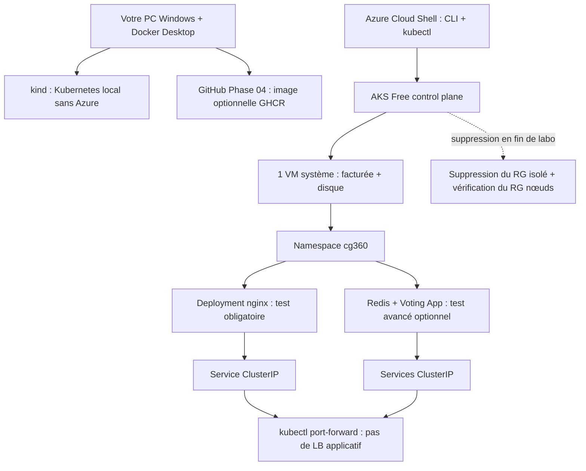

# CLOUDGUARD 360 — PHASE 08 | Kubernetes local + Azure AKS

**Édition 21 novembre 2026 — laboratoire final, dernier jour Azure Free Trial**  
**Langue : français | Mode : un seul laboratoire complet | Objectif : comprendre, exécuter, vérifier, sauvegarder et nettoyer**

> Cette formation respecte le programme initial CloudGuard 360 : Phase 08 = Kubernetes `kind` en local, puis AKS temporaire. Ce package **n'efface pas** les réseaux créés en Phase 01, ne prend pas le contrôle des projets Terraform des Phases 01–04, ne crée ni ACR, ni Firewall, ni Load Balancer applicatif. **L'AKS lui-même peut créer des ressources réseau administrées et facturables, notamment un équilibreur de charge de plateforme, et un groupe de ressources géré.** Aucun Service Kubernetes de type `LoadBalancer` n'est créé par nos manifests.

## 0. Avant tout : protéger votre dernier jour Azure (indispensable)

1. Dans Azure Portal, consultez **Subscriptions → Azure subscription 1**, vérifiez `State`, la date exacte d'expiration du crédit et le statut Free Trial. Dans **Cost Management + Billing**, consultez les crédits restants et le détail des ressources facturées. Ne présumez pas que l'expiration sera à 23h59.
2. Si vous avez un abonnement Free Trial non converti, Microsoft indique que les services sont désactivés lorsque le crédit est épuisé ou à l'expiration des 30 jours. Si votre offre a été convertie en *pay-as-you-go*, les ressources peuvent continuer à facturer ! Les coûts ne s'arrêtent pas nécessairement à la date du crédit.
3. **Sauvegardez tout de suite** vos scripts et projets existants sur votre PC : fichiers `.tf`, `.tfvars` non sensibles, README, YAML, preuves, rapports. Ne mettez jamais les Terraform States, `.kube/config`, `hosts.yml` GitHub ou secrets sur un dépôt public. Les états Terraform peuvent contenir des données sensibles, et doivent rester en stockage privé et protégé.
4. Exportez les vues utiles du portail (`rg-cg360-network`, `rg-cg360-app`, `ca-cg360-voting`) et un inventaire en lecture seule :

```bash
mkdir -p ~/clouddrive/cloudguard360/final-export
az group list --query '[].{Group:name,Location:location}' -o table > ~/clouddrive/cloudguard360/final-export/resource-groups.txt
az resource list -g rg-cg360-network --query '[].{Name:name,Type:type,Location:location}' -o table > ~/clouddrive/cloudguard360/final-export/network-inventory.txt
az resource list -g rg-cg360-app --query '[].{Name:name,Type:type,Location:location}' -o table > ~/clouddrive/cloudguard360/final-export/app-inventory.txt
```

Ces commandes **ne modifient aucune ressource**. Enregistrez les résultats localement avant la fin de l'abonnement. Le contenu de votre `clouddrive` peut ne pas être accessible ensuite.

## 1. Architecture de cette phase



**Important :** AKS gère Kubernetes, mais vous payez les nœuds, les disques et certaines ressources réseau. Le niveau gratuit d'AKS concerne le plan de contrôle, pas tout le cluster. Les documents AKS actuels ne prennent **pas en charge les VM B-series pour les pools système**, et imposent une taille d'au moins **4 vCPU et 4 GiB** pour le pool système. Nous utilisons `Standard_D4s_v5` comme valeur de départ **conditionnelle**, pas comme promesse de disponibilité : quotas régionaux et restrictions des essais gratuits peuvent empêcher la création. Si votre abonnement n'autorise pas les 4 vCPU nécessaires, **ne forcez pas**, poursuivez le parcours kind en local.

## 2. Les 7 concepts à comprendre avant d'exécuter

| Concept | Analogie | Réalité Kubernetes |
|---|---|---|
| **Cluster** | Usine entière | Ensemble de machines gérées par un plan de contrôle |
| **Node** | Atelier de l'usine | VM exécutant les charges applicatives |
| **Pod** | Équipe de travail | Unité d'exécution contenant un ou plusieurs conteneurs |
| **Deployment** | Responsable de production | Garantit le nombre souhaité de réplicas, gère les mises à jour |
| **Service** | Numéro d'accueil stable | Point de contact réseau indépendant des IP changeantes des Pods |
| **Namespace** | Département | Organisation logique des ressources; ce n'est **pas** une frontière de sécurité complète |
| **Probe** | Contrôle de santé | `readiness` décide si le Pod reçoit du trafic; `liveness` déclenche un redémarrage en cas d'échec répété |

**Différence Docker/Kubernetes :** Docker peut démarrer un conteneur. Kubernetes contrôle et rapproche en permanence **état désiré** (replicas=1) et **état observé**. Si le Pod disparaît, le contrôleur le remplace.

**Différence RBAC :** le rôle `Reader` Azure sur un RG ne donne pas automatiquement des permissions Kubernetes internes. Azure RBAC gère les ressources Azure; Kubernetes RBAC régit les objets K8s selon la configuration d'authentification et d'autorisation du cluster. Le quickstart utilise les identifiants d'administrateur courants du lab; ne réutilisez pas cette configuration pour la production.

## 3. Prérequis et frontière entre PC / Cloud Shell

**Azure Cloud Shell Bash :** Azure CLI, `kubectl`, fichiers YAML, commandes `az aks`. N'utilisez **pas** `docker build`, `docker run` ou `kind create cluster` dans Cloud Shell (pas de daemon Docker standard). La création AKS peut consommer du crédit ou échouer selon quota.

**PC Windows :** Docker Desktop avec backend WSL2, client `kubectl`, binaire officiel `kind` (https://kind.sigs.k8s.io/docs/user/quick-start). Le cluster local peut fonctionner même une fois Azure expiré. `kind` exige un moteur de conteneurs accessible; démarrer Docker Desktop d'abord.

### Installer le ZIP dans Cloud Shell

Depuis la page Azure Portal, utilisez **Cloud Shell → Manage files → Upload** et envoyez `CloudGuard360_Phase08_Kubernetes_AKS.zip`.

```bash
mkdir -p ~/clouddrive/cloudguard360
unzip -n ~/CloudGuard360_Phase08_Kubernetes_AKS.zip -d ~/clouddrive/cloudguard360
cd ~/clouddrive/cloudguard360/CloudGuard360_Phase08_Kubernetes_AKS
ls -lah
```

Restez dans ce dossier jusqu'à la fin de la phase pour que tous les chemins relatifs fonctionnent.

## 4. Exercice AKS temporaire — à réaliser aujourd'hui seulement si budget/quota disponibles

### Étape A — Contrôler l'abonnement, la région et le quota (lecture seule)

```bash
cd ~/clouddrive/cloudguard360/CloudGuard360_Phase08_Kubernetes_AKS
export ARM_SUBSCRIPTION_ID="$(az account show --query id -o tsv)"
export CG360_AKS_REGION="$(az group show -n rg-cg360-app --query location -o tsv)"
export CG360_AKS_SIZE="Standard_D4s_v5"
bash scripts/00-preflight.sh
```

Examinez les sorties et contrôlez visuellement les quotas dans **Azure Portal → Subscriptions → Usage + quotas** : la VM `Standard_D4s_v5` doit être autorisée, la région doit permettre AKS, et le quota vCPU régional et de famille doit suffire. Le résultat `list-skus` indique la disponibilité/catalogue, **pas** nécessairement votre autorisation ni votre quota réel. Si `CG360_AKS_REGION` est bloquée dans votre Free Trial, cherchez **une autre région autorisée** et revalidez coût + quota; ne choisissez pas une région arbitraire. `az aks create` peut échouer à cause d'une politique, du quota ou d'un SKU indisponible.

**Pourquoi créer un RG distinct ?** Nous voulons pouvoir supprimer le labo AKS sans jamais supprimer `rg-cg360-network` ou `rg-cg360-app`. Notre nom unique est `rg-cg360-aks-lab`.

### Étape B — Créer AKS (déploiement facturable et explicite)

Après avoir consulté les coûts estimés (Azure Pricing Calculator, tarification VM/stockage/réseau) et confirmé budget et quota :

```bash
bash scripts/01-create-aks.sh
```

Il vous demandera `CREATE-AKS` avant de créer :
- 1 groupe `rg-cg360-aks-lab`;
- 1 cluster `aks-cg360-lab`, plan de contrôle `--tier free`;
- 1 VM système `Standard_D4s_v5`, OS Ubuntu;
- un réseau Azure CNI Overlay **distinct de vos VNets historiques**;
- des ressources gérées par AKS dans un deuxième RG `MC_...`.

**Attendu :** `kubectl get nodes -o wide` affiche un nœud `Ready`. Si l'Azure CLI indique `QuotaExceeded`, `RequestDisallowedByAzure` ou `SkuNotAvailable`, stoppez la tentative : n'appliquez pas de solutions payantes improvisées. Inspectez `rg-cg360-aks-lab`; si des ressources existent, lancez la procédure de nettoyage.

### Étape C — Déployer et tester sans IP publique applicative

```bash
kubectl config current-context
bash scripts/02-deploy-check.sh
```

Le script vérifie `aks-cg360-lab` ou `kind-cg360`, puis crée :
- un Namespace `cg360`;
- un Deployment `cg360-web` (1 Pod NGINX);
- un Service interne **ClusterIP**;
- deux sondes de santé (`readiness`, `liveness`) et des limites CPU/RAM.

Le script lance aussi un port-forward local sur le port **18080**, récupère le HTML et confirme la présence de `nginx`. **PAS** d'IP publique, PAS de LoadBalancer applicatif.

```bash
kubectl -n cg360 get pods -o wide
kubectl -n cg360 get svc
kubectl -n cg360 describe deployment cg360-web
kubectl -n cg360 logs deployment/cg360-web --tail=30
```

*À comprendre :* `kubectl apply` décrit l'état souhaité, `rollout status` attend l'état déployé, `get` observe, `describe` montre configuration/événements, `logs` montre la sortie des conteneurs. `port-forward` ouvre un tunnel uniquement pendant la commande.

### Étape D — Faire une expérience de résilience

```bash
# Consulter le Pod actuel
kubectl -n cg360 get pods -l app=cg360-web

# Simuler la perte d'un Pod applicatif de démonstration
kubectl -n cg360 delete pod -l app=cg360-web

# Vérifier que le Deployment recrée un Pod
kubectl -n cg360 rollout status deployment/cg360-web --timeout=180s
kubectl -n cg360 get pods -l app=cg360-web
```

**Question de compréhension :** pourquoi un nouveau Pod apparaît-il ? Parce que le Deployment exige 1 réplica. Le contrôleur Kubernetes détecte la différence entre l'état actuel (0) et l'état cible (1), puis programme un remplaçant. La donnée stockée dans un Pod temporaire n'est pas forcément conservée.

### Étape E — Bonus : déployer votre VRAIE Voting App + Redis (si la Phase 04 a publié son image)

Nous avons un manifest prêt pour l'image produite par votre dépôt `NabilNet/cloudguard360-phase04` :
- Redis (`redis:7-alpine`), accessible uniquement au Service interne `cg360-redis`;
- Voting App Flask, configurée avec `REDIS=cg360-redis`;
- 2 Deployments, 2 Services `ClusterIP`, 2 probes.

Le **prérequis** est une image GHCR **réellement construite**, publiée et accessible par le cluster. Le guide précédent utilisait une image GHCR taguée par SHA git complet (40 caractères) :

```bash
# Uniquement si le workflow 02-publish a réellement réussi
cd ~/clouddrive/cloudguard360/CloudGuard360_Phase08_Kubernetes_AKS
SHA="$(gh api repos/NabilNet/cloudguard360-phase04/commits/main --jq .sha)"
IMAGE="ghcr.io/nabilnet/cloudguard360-vote:$SHA"
echo "$IMAGE"
# Vérifier dans GitHub Packages que le tag exact existe ET que le package est public.
bash scripts/04-vote.sh "$IMAGE"
```

Si la Phase 04 n'a pas publié cette révision, **ne lancez pas** ce bonus : le cluster afficherait `ImagePullBackOff`. GHCR peut exiger une authentification si le package est privé. L'absence d'image GHCR ne bloque **pas** la réussite du labo AKS avec NGINX.

Test Voting App (commande interactive; conservez la session ouverte et testez le navigateur local si `kubectl` tourne sur votre PC) :

```bash
kubectl -n cg360 port-forward svc/cg360-vote 18081:80
```

Depuis le **même environnement local**, on peut faire `curl http://127.0.0.1:18081/`. Sur Cloud Shell, utilisez une seconde session Cloud Shell pour la requête HTTP ou une redirection de port temporaire; la page n'est pas automatiquement accessible dans le navigateur de votre PC.

### Étape F — Collecter les preuves

```bash
cd ~/clouddrive/cloudguard360/CloudGuard360_Phase08_Kubernetes_AKS
bash scripts/03-evidence.sh
```

Le script archive : statut des nœuds, Pods, Services, événements, logs, version et zone AKS (en cas d'AKS), dans `evidence/<timestamp>.zip`. Il n'exporte pas les credentials Kubernetes.

Dans Azure Cloud Shell, utilisez **Manage files → Download** pour télécharger cette archive **sur votre ordinateur immédiatement**, avant l'expiration de l'abonnement.

### Étape G — Supprimer les ressources AKS (ne pas repousser au lendemain)

**Après avoir sauvegardé les preuves :**

```bash
bash scripts/05-delete-aks.sh
```

Tapez `DELETE-LAB` après avoir vérifié les ressources concernées. Le script ne supprime que `rg-cg360-aks-lab` et vérifie la disparition du RG système géré par AKS. **Ne supprimez jamais `rg-cg360-app` ou `rg-cg360-network` par automatisme.**

Si une suppression reste incomplète ou si `MC_...` persiste, inspectez dans Azure Portal → Resource Groups et traitez l'échec immédiatement. La suppression peut prendre du temps. Pour une souscription convertie à pay-as-you-go, les coûts peuvent continuer tant que certaines ressources existent.

## 5. Kubernetes local gratuit avec kind — aujourd'hui ou après l'expiration Azure

Sur votre ordinateur Windows, ouvrez **PowerShell** (pas Azure Cloud Shell). Installez d'abord Docker Desktop + WSL2, `kubectl`, `kind` avec les installations officielles, puis vérifiez :

```powershell
docker version
kubectl version --client
kind version
```

Copiez et décompressez le ZIP sur votre ordinateur, puis ouvrez le dossier racine du projet en PowerShell :

```powershell
kind create cluster --name cg360
kubectl config use-context kind-cg360
kubectl get nodes
kubectl apply -f .\k8s\00-smoke.yaml
kubectl -n cg360 rollout status deploy/cg360-web --timeout=180s
kubectl -n cg360 get pods,svc
kubectl -n cg360 port-forward svc/cg360-web 8080:80
```

Dans le navigateur de votre PC, ouvrez **http://localhost:8080**. Pour reprendre le terminal, faites `Ctrl+C`, puis :

```powershell
kubectl -n cg360 delete pod -l app=cg360-web
kubectl -n cg360 rollout status deploy/cg360-web --timeout=180s
kind delete cluster --name cg360
```

**Le code YAML ne change pas :** ce sont les mêmes concepts Kubernetes sur votre PC et sur AKS; les différences concernent l'implémentation du cluster et l'intégration réseau/cloud. Le coût local dépend de votre machine, pas de votre crédit Azure.

## 6. Tableau d'évaluation (validez personnellement)

| Critère | Preuve à conserver | Validation |
|---|---|---|
| Sécurité de la souscription | Capture du statut/solde Azure | À vérifier |
| Admission AKS / quota | `00-preflight.sh` | À vérifier |
| AKS temporaire opérationnel, si autorisé | `kubectl get nodes` = Ready | À vérifier |
| Deployment NGINX | `rollout status` = success | À vérifier |
| Service & réponse HTTP | `02-deploy-check.sh` = PASS | À vérifier |
| Résilience | Pod recréé après suppression | À vérifier |
| Voting App (facultatif) | Frontend + Redis fonctionnels | Facultatif |
| Rapport technique | ZIP `evidence/` téléchargé sur PC | À vérifier |
| Nettoyage AKS | `rg-cg360-aks-lab` + `MC_...` absents | À vérifier |
| Compétences durables | Kubernetes local `kind` | À vérifier |

**Ne déclarez pas un déploiement AKS réussi si le cluster n'a pas réellement atteint Ready et si l'application n'a pas été testée.** Si Azure refuse AKS pour raisons de quota ou de politique, le parcours kind reste une validation technique pertinente; documentez honnêtement la limitation du cloud.

## 7. Dépannage rapide

| Erreur | Cause probable | Action sûre |
|---|---|---|
| `RequestDisallowedByAzure` | Région ou politique de souscription restreinte | Vérifier régions autorisées, ne pas improviser |
| `QuotaExceeded` / `OperationNotAllowed` | vCPU insuffisants pour le pool système | Ne pas choisir B-series; revenir à kind |
| `SkuNotAvailable` | SKU/région indisponibles | Vérifier `az vm list-skus`, quotas et région |
| `ImagePullBackOff` | Image GHCR manquante ou privée | Vérifier tag SHA, publication et visibilité |
| `CrashLoopBackOff` | App ne démarre pas / Redis inaccessible | `kubectl logs`, `describe pod`, variable REDIS |
| `Pending` | CPU/RAM insuffisants ou problèmes de scheduling | `kubectl describe pod`, événements, quotas |
| `Forbidden` | Permissions Kubernetes RBAC insuffisantes | Vérifier identité, contexte et droits, ne pas contourner |
| Port-forward déjà occupé | Port local 18080 utilisé | Arrêter l'autre processus ou choisir autre port |
| Suppression RG incomplète | Dépendance ou erreur Azure | Azure Portal et liste des ressources, conserver preuve |

## 8. Mini entretien professionnel — trois questions

1. **Quelle différence entre Pod, Deployment et Service ?** Un Pod exécute l'application; un Deployment maintient le nombre de Pods et leur mise à jour; un Service offre une adresse logique stable aux clients.
2. **Pourquoi Kubernetes recrée un Pod supprimé ?** Le contrôleur rapproche en continu état désiré (`replicas: 1`) et état réel; la suppression manuelle n'altère pas la cible du Deployment.
3. **Pourquoi AKS Free n'est-il pas totalement gratuit ?** Le plan de contrôle peut être gratuit, mais les nœuds VM, les disques et le réseau sous-jacent peuvent être facturés. La suppression des ressources doit être vérifiée.

## 9. Sources vérifiées (novembre 2026)

- Azure Free Account : https://learn.microsoft.com/en-us/azure/cost-management-billing/manage/avoid-charges-free-account
- AKS Free/Standard/Premium : https://learn.microsoft.com/en-us/azure/aks/free-standard-pricing-tiers
- AKS System Node Pools (SKU B non pris en charge) : https://learn.microsoft.com/en-us/azure/aks/use-system-pools
- AKS Azure CLI : https://learn.microsoft.com/en-us/cli/azure/aks
- Azure CNI Overlay : https://learn.microsoft.com/en-us/azure/aks/azure-cni-overlay
- kind : https://kind.sigs.k8s.io/docs/user/quick-start/
- Azure RG deletion : https://learn.microsoft.com/en-us/cli/azure/group

**Sécurité :** ce projet est un environnement d'apprentissage, pas une architecture de production. Les contrôles de conformité, la résistance des identités, la gestion des secrets, la haute disponibilité, les dépendances logicielles et la posture réseau exigeraient un programme distinct avant toute utilisation réelle.
